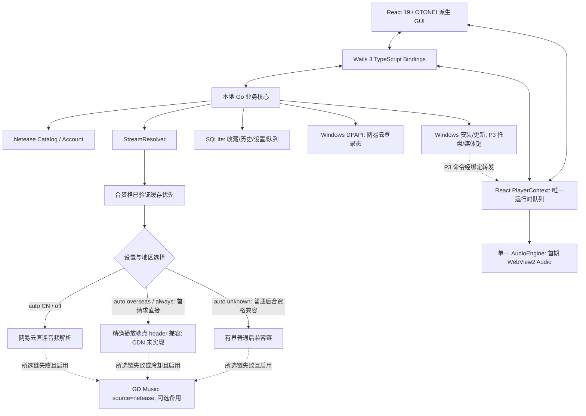
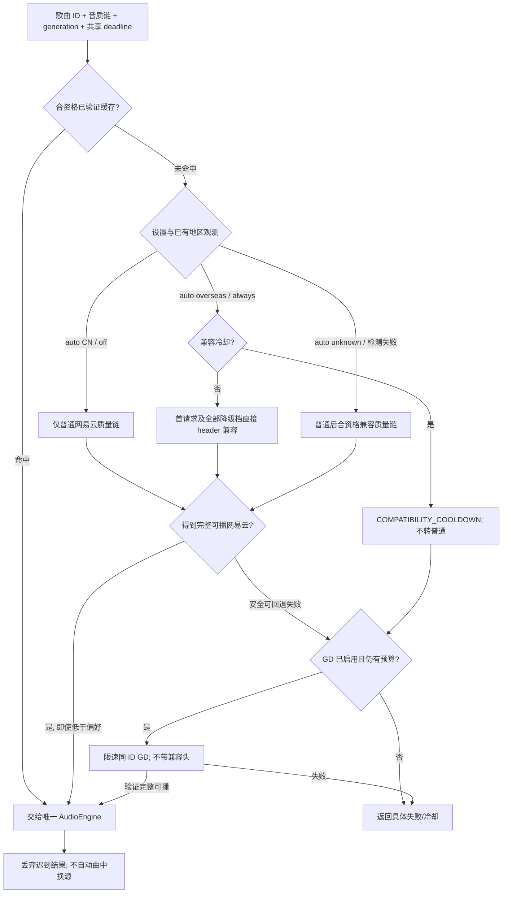

# 独立 Windows 网易云音乐客户端实施方案

> 文档版本: v1.6 (0.4.0 实现同步与分期验收边界)  
> 日期: 初稿 2026-10-31; 实现同步 2026-11-02  
> 项目代号: OTONEIGO (暂按用户确定的新目录命名)  
> 目标平台: Windows 10/11 x64 优先  
> 状态: **P0 已开始, 核心门槛未全部通过; 三个参考项目副本保持只读并被 Git 忽略**  
> 修订说明: 当前工程已接入地区控制器、受限 header 取流编排、schema 5 本地收藏/历史/设置/歌单、SQLite 整库检索、收藏/历史分页、关键词历史、封面/歌词缓存与磁盘音频缓存和固定字段诊断；GD 严格回退已按有限 MP3 原生证据开放 `gdReleaseValidated = true`，用户设置仍默认关闭，账号仍未实现。CDN/no-cache 尚未实现。源码落地不等于 P0 全过或 P1/P2 已交付；真实绑定/原生媒体结果和 A—E 决策见 [P0 验证记录](docs/validation/p0-validation.md)。三个参考副本只读且被 Git 忽略，不读旧用户数据，不做导入/导出/备份/恢复。

> 本次决策: **独立仓库、Windows 专项、React + Wails 3 + Go、无 Firebase、仅网易云曲库、GD Music 网易云音源可选备用、彻底移除 UNM**

---

## 当前实现索引（2026-11-02 / 0.4.0）

2026-11-02 盘点后，用户明确暂缓全部登录相关功能；非账号工作按[当前实施路线](docs/planning/roadmap.md)依次执行。本轮封面/歌词缓存、整库检索、收藏分页/关键词历史已接入源码；当前版原生资源/查询与强杀耐久、独立海外直兼容启动、最终构建/审计及便携 ZIP/覆盖更新有限用例已通过，后续桌面/发布候选不冒充已经完成。旧阶段复选框保留历史语境，当前状态以实施路线和实际验收记录为准。

本方案保留产品目标、初始设计草案与历史实验。描述“建议/拟议/草案”的接口和目录不是当前 API 清单；当前契约以[架构](docs/architecture/architecture.md)、[存储](docs/architecture/storage.md)、[适配器](docs/architecture/netease-adapter.md)和[海外兼容说明](docs/compatibility/overseas-compatibility-p0.md)为准，验收以 [P0 记录](docs/validation/p0-validation.md)为准。

| 边界 | 当前实现 | 未交付或待证 |
| --- | --- | --- |
| 宿主/播放器 | 单 Go module、Wails 3/React、唯一 PlayerStore 与 HTMLAudioElement、生成绑定、暂停恢复与取消 | 不能用浏览器 mock 替代原生 WebView2；P0-A/E 仍须独立审查 |
| 目录/解析 | 匿名搜索、单曲/歌词；缓存先行，按地区/设置预选普通或首请求直接 header 兼容，所选网易云失败后可选 GD；共享非会员 26 秒/已验证会员 40 秒 deadline | 账号/QR/DPAPI/云端歌单未实现；普通失败不是地区根因证明 |
| 地区 | 异步 trace 国家观测、auto/always/off、TTL/重试、路由/接口通知及手动刷新、network generation | 出口分流、中国 A/B、休眠/VPN 实效需验收；CDN/no-cache 未实现 |
| 本地库 | SQLite schema 5；整库检索、每页最多 200 条收藏/历史、完整收藏 ID 成员集、关键词历史、设置、队列与本地歌单；收藏/两类历史不自动裁剪 | 100 个本地歌单、单歌单/队列 1000 首、队列 2 MiB 等保护仍保留；当前版本有限原生耐久已通过；旧 schema 升级使用独立合成 fixture，不新增旧产品迁移或用户备份恢复 |
| 资源缓存 | 默认封面/歌词共享 1 GiB、音频独立 20 GiB；校验、LRU、关闭/清理；封面经 Wails 同源资产路径，无新 listener | 当前版本原生离线资源、实际同散列 404 恢复、清理与生产便携覆盖更新有限用例通过；WebP/AVIF 走可信原地址退路 |
| GD | 同 ID netease-only、受信任媒体与 audioinfo 有界 MP3/FLAC/WAV 结构、码率/时长校验、限速/合并/短缓存/冷却 | 有限 MP3 样本已原生完整播放并开放 capability；用户默认关闭，不覆盖全部版本/权益/音质 |
| 诊断 | 固定字段白名单 JSONL、1 MiB 轮换；不记 URL/IP/凭据/响应体 | API 阶段日志不是完整媒体验收或因果证明 |

P0 分组统一为 A 宿主基础、B 网易云搜索/登录/取流、C 地区检测/兼容、D GD 备用、E Windows 原生媒体完整性/音质。完整本地库等部分后续部件已提前落地，不表示跳过 P0 阶段门。

## 1. 执行摘要

  建议从 OTONEI 现有稳定版本继承 React GUI、主题、歌词、播放队列等成熟模块, 在**新建的独立仓库**中构建 Windows 桌面音乐客户端。桌面容器优先选 **Wails 3 + WebView2**, 通过 Wails 生成的 TypeScript 绑定调用内嵌 Go 核心, **不部署自己的远程 API 服务器, 也不运行额外的本地 HTTP API 进程**

  产品只使用**网易云音乐作为曲目目录和账号体系**: 搜索、歌曲、专辑、歌手、歌单、推荐、收藏以及歌曲身份都统一使用网易云曲库及网易云歌曲 ID。实际播放地址区分两个独立来源:

1. **网易云取流**: 合资格已验证缓存先行；网络按设置与地区选择普通或兼容路径。auto+CN/off 仅普通，auto+overseas/always 首请求及全部降级档直接兼容、不做普通预请求；auto+unknown（含检测失败）保留普通后合资格兼容。兼容仅为精确播放端点 header，CDN 改写未实现，不改变歌曲身份或会员权益
2. **GD Music 的 `netease` 音源**: 仅在所选网易云有限音质链均失败且用户已启用时, 在同一有限预算和限速规则内尝试**同一网易云歌曲 ID** 的备用地址; 仅在提供方允许、资源可访问的情况下使用

  **不再集成 UNM (UnblockNeteaseMusic)**, 不使用酷我、酷狗、咪咕、QQ、JOOX、Bilibili 等跨曲库来源, 不做跨平台歌曲匹配, 也不承诺非会员一定能播放 VIP 曲目或获得会员音质

  **彻底移除 Firebase**: 不保留 Google/邮箱登录、Firestore、Firebase 数据同步及相关前端生命周期依赖。新客户端无需登录也可以使用基本功能; 网易云账号为可选的功能增强。收藏、历史、设置、播放队列优先使用本地 SQLite, 网易云账号凭据通过 Windows 当前用户作用域的安全机制保存

  初期**保留 OTONEI 的 `HTMLAudioElement` 播放核心**, 不复制 go-musicfox 主项目的 TUI/播放队列/原生播放器。先验证闭环, 再决定是否引入原生音频引擎和桌面增强

### 1.1 一句话定位

**「以网易云曲库为唯一音乐身份来源, 以本地 Go 核心驱动的 Windows 音乐客户端; 独立于 OTONEI, 无自建服务器, GD Music 的网易云接口仅为可选备用播放地址」**

### 1.2 与旧 MD 方案的实质变化

| 维度 | 旧方案 (OTONEI 双端增强) | 新方案 (最终建议) |
| --- | --- | --- |
| 项目形态 | 继续发展 OTONEI, 增加 Desktop | 新建**独立 Windows** 仓库 |
| 目标平台 | Web/PWA + Windows | **仅 Windows**, 暂不考虑移动端 |
| 前端 | 共享 Web/Desktop React | 继承 OTONEI React, 允许 Windows 专项重构 |
| 自建后端 | 桌面本地 Go | **Wails 内嵌 Go**, 不开独立 HTTP 端口 |
| 音乐曲库 | GD 多音源 + 网易云账号 | **只保留网易云曲库和 ID** |
| 音频解析 | 多提供方解析 | 缓存优先、按地区选择网易云访问路径, GD `netease` 仅失败备用 |
| UNM | 旧版仅不纳入 MVP | **从代码及 Go 依赖中彻底移除** |
| 账号/同步 | Firebase + 网易云双账号 | **仅可选网易云登录**, 本地数据为主 |
| 本地数据 | 原 IndexedDB/Firestore 优先 | **SQLite**, DPAPI 保护凭据 |
| 播放引擎 | 浏览器引擎首期保留 | **同样首期保留**, 验证后按需更换 |
| 维护负担 | 持续保证 Web/PWA 零回归 | 只积极维护新 Windows 客户端 |

---

## 2. 已核对的代码基线与证据

| 仓库 | 核对提交 | 相关事实 |
| --- | --- | --- |
| [voici5986/OTONEI](https://github.com/voici5986/OTONEI) | `a54f0bafb9932edfe061acdb6ef1bd55f707c4f0` | `package.json` v1.8.0, React 19、Vite 8、Firebase、localforage、GD 音源、现有播放引擎 |
| [go-musicfox/go-musicfox](https://github.com/go-musicfox/go-musicfox) | `12169a71098f8b8607bcf655eaddabf57ca14daf` | Go TUI 主项目 GPL-3.0, 含网易云登录、音频处理、UNM 和播放上报等实现 |
| [go-musicfox/netease-music](https://github.com/go-musicfox/netease-music) | `912f2cf2b8bf772c804c6cd4b4f31f11773c7b93` | 独立 API 仓库标注 MIT, **但源码和 `go.mod` 直接引用 GPL-3.0 的 UNM** |
| [go-musicfox/UnblockNeteaseMusic](https://github.com/go-musicfox/UnblockNeteaseMusic) | 检查仓库元数据于 2026-10-31 | 许可证标注 GPL-3.0; 新项目明确不用该模块 |
| [GD API 参考](https://github.com/voici5986/OTONEI/blob/a54f0bafb9932edfe061acdb6ef1bd55f707c4f0/docs/reference/GD_STUDIO_API.md) | 文档内更新日期 2026-06-26 | 提供 `source=netease` 的 URL 查询及音质字段, 但**不保证 VIP/完整音频/真实高音质**; 参考页注明非商业与调用限制 |
| [NetEaseMusicWorldNext](https://github.com/kogamitora/NetEaseMusicWorldNext) | 本地 manifest v1.0.0, 文件 SHA-256 见来源清单 | GPL-3.0 Chrome 扩展; 固定请求头与部分 CDN 域名改写; 无自动地区检测, 不复制源码或引入扩展运行时 |

  第三个只读参考 `NetEaseMusicWorldNext-master/` 用于观察播放 header/CDN 机制, 不复制其代码、不引入扩展运行时; 具体观察与限制见[海外兼容说明](docs/compatibility/overseas-compatibility-p0.md)。隔离试验已验证受限 header 对一个样本有效, 并经测试桥接完成真实 WebView2 播放; 在该 2026-10-31 历史检查点，正式运行代码尚未集成海外检测/兼容、账号或 GD；当前集成状态已由上方 0.4.0 索引取代，账号继续暂停。正式 P1 前须完成 A—E 验证工作与明确 go/no-go 决策; 可选能力失败可禁用/延期, 但未测试不能计为成功或已完成, 也不能宣称可选功能交付。

---

## 3. 产品范围与不可变原则

### 3.1 基础首版要求与可选增强

1. Windows 桌面应用可通过安装包安装、启动、关闭、升级; 前端和 Go 一同打包, 无需自建服务器
2. 不登录网易云时, 仍可以搜索网易云公开曲库、播放可公开获取的曲目、收藏、本地历史及基础设置
3. 网易云登录为独立验收的可选增强: 扫码登录、资料、个人歌单、喜欢的音乐、登录态恢复和退出; 未通过时基础 MVP 不宣称包含账号功能
4. 只使用网易云的歌曲身份 (`neteaseSongId`) 和曲库元数据; 不允许将其他平台的 ID 混入主歌曲表
5. 播放先复用合资格已验证缓存，再按设置与地区选择网易云普通/兼容路径；已确认海外的 auto 与 always 从首请求直接兼容，unknown 才保留普通后兼容；所选网易云链失败后才用已启用 GD `source=netease`，完整网易云结果立即使用，不用 GD 追高码率，全部由**同一个播放器**执行
6. 保留真实音质/实际播放时长的判断; 对失效、试听、未授权和非完整资源给出明确状态
7. SQLite 持久保存本地收藏、历史、设置及队列快照; 保证事务式 schema 迁移、异常退出后的已提交数据读取及普通升级保留数据
8. 没有任何运行时 Firebase/Firestore 依赖; 没有 UNM 代码导入、间接 Go 依赖或编译链接
9. 网易云登录态安全存储, 禁止日志记录 Cookie、完整授权令牌或敏感响应
10. 没有任何功能依赖开发者自己部署的 Linux VPS、Cloudflare Pages Functions 或 Docker API

### 3.2 首期明确不做 (Won't)

- 用户侧文件导入、导出、备份、恢复及 OTONEI 数据迁移, 包括 UI、桥接 API、实现和测试; 不安排自动定时备份或便携备份。将来有明确新需求时再单独评估
- Web、PWA、Android、iOS、macOS、Linux 客户端
- 再建一个自有用户账户系统, 或以 Firebase 替代本地数据
- 酷我、酷狗、咪咕、QQ、JOOX、Bilibili、YouTube Music 等独立曲库搜索及跨平台匹配
- UNM、修改会员权限响应、模拟付费权益、DRM 破解或其他权限绕过机制
- 承诺免费获取所有 VIP 曲目、无损/Hi-Res 或未授权资源
- 将「音频地址来自 GD」伪装成「从网易云官方成功授权」
- 自动批量修改或删除用户网易云已有歌单、喜欢列表
- 将 go-musicfox 主项目的 GPL-3.0 TUI/播放业务代码直接复制进 MIT 新项目
- 首期直接重写整个 React GUI、状态管理和音频引擎
- 在新客户端中复用 OTONEI 的 Firebase 账号、同步队列或需要云端凭据的旧状态

### 3.3 重要的产品规则

  **单一音乐目录不等于单一流媒体主机**。所有搜索、页面、歌词、封面和歌曲身份均来自网易云相关元数据; 音频流可以通过主请求或备用请求获得, 但始终属于同一 `neteaseSongId` 的播放尝试

  GD 只是一个可能不可用的第三方服务, 不是可以保证会员权益的「解锁服务」。如果授权或播放条件不满足, 客户端应显示不可播放, 不通过无限重试或伪造音质信息掩盖失败

---

## 4. 推荐技术架构



### 4.1 三个边界: 音乐目录、播放地址、播放执行

| 模块 | 职责 | 是否需要第二套实现 |
| --- | --- | --- |
| `NeteaseCatalog` | 搜索、歌曲信息、歌单、歌手、专辑、推荐等 | **否**, 只保留网易云 |
| `StreamResolver` | 合资格缓存先行→按设置/地区选普通或直接兼容（unknown 普通后兼容）→失败时 GD, 检查地址有效性、音质、试听长度 | **两个 provider adapter, 一个决策器; 访问策略不是新曲库** |
| `PlaybackEngine` | 播放、暂停、进度、音量及执行结果事件; 不管理队列 | **否**, 保留单一实例 |
| `NeteaseSession` | 二维码登录、Cookie、刷新/过期、退出 | **一个可选账号** |
| `LocalLibrary` | SQLite 收藏、历史、用户设置与队列 | **一个本地数据库** |
| `NeteaseSync/Reporter` | 云端歌单操作、可选播放记录上报 | **独立可关闭模块** |

  React 只依赖稳定的 TypeScript 服务契约, 不直接操作网易云 Cookie, 也不直接拼装 GD 请求。Go 层负责网络、权限状态分类、来源标签、超时和日志脱敏。React `PlayerContext` (或其等价单一模块) 独占运行时队列; `AudioEngine` 是单一执行器, Go/SQLite 只保存快照, 不建立第二份可变队列。托盘、媒体键和迷你窗口命令都转发到同一状态所有者

  Go 出口检测已实现国家码观测与 CN/overseas/unknown 分类，不依据系统语言/地区，也不传递或持久化原始公网 IP。启动异步检测、15 分钟 TTL、30 秒最短重试、Windows 路由/接口通知及补充检测已接入；实际 VPN/恢复和分流效果仍须验收。`auto/always/off`、白名单、取消和剩余限制以[海外兼容 P0 说明](docs/compatibility/overseas-compatibility-p0.md)为准。

### 4.2 避免误用「Go API 服务」这一术语

  本项目的 Go 是**内嵌业务层**, 不是独立 HTTP 服务器; 只需要 Wails Service 绑定, 不必 `listen(127.0.0.1:xxxx)`、部署 VPS、Docker 或配置 Caddy

  Windows 程序离线时仍能打开界面、浏览本地历史和设置; 搜索、在线播放、云端歌单需要访问网易云或 GD 的外部网络, 因而**不等于离线音乐服务**

### 4.3 初始目标目录结构（2026-10-31 草案，非当前文件清单）

```text
music-client/                        # 独立新仓库, 名称待定
├── frontend/
│   ├── src/
│   │   ├── app/                     # 路由、初始化和全局错误处理
│   │   ├── components/              # OTONEI 继承的 UI/歌词/搜索/列表
│   │   ├── contexts/                # 单队列状态 + 播放控制
│   │   ├── services/
│   │   │   ├── desktopBridge.ts      # Wails 绑定适配器
│   │   │   ├── musicCatalog.ts       # 网易云目录服务契约
│   │   │   ├── playbackService.ts    # 播放引擎接口
│   │   │   └── localLibrary.ts       # 本地数据服务契约
│   │   ├── types/
│   │   │   ├── track.ts
│   │   │   └── stream.ts
│   │   └── styles/                  # 继承现有 UI 规范与主题
│   └── package.json
├── backend/
│   ├── go.mod
│   ├── main.go                     # Wails 程序入口
│   ├── internal/
│   │   ├── catalog/                # 网易云搜索/歌单/歌词/资料
│   │   ├── account/                # 二维码登录、Cookie、DPAPI
│   │   ├── stream/
│   │   │   ├── resolver.go
│   │   │   ├── netease.go
│   │   │   └── gd_netease.go
│   │   ├── storage/                # SQLite schema / 事务式 migrations
│   │   ├── reporter/               # 关闭默认的可选上报
│   │   ├── windows/                # 托盘、媒体键、用户目录
│   │   └── appservice/             # Wails 对外服务方法
│   └── third_party/                # 合规精简的网易云 API 实现, 视方案而定
├── assets/                         # 运行图标、安装资源
├── scripts/                        # 测试/构建/依赖许可证扫描
├── tests/                          # 媒体与登录手动验证方案
├── docs/
│   ├── architecture.md
│   ├── licenses.md
│   └── storage.md                  # schema、持久化与异常退出处理
└── .github/workflows/              # 单一 Windows CI/发布
```

  具体路径需在 Wails 3 工程初始化后确定; 不应为了遵循目录样例而额外增加多个 Go module 或构建系统。可以先采用一个 Go module + 一个前端工程, 后续再按真实复杂度拆分

---

## 5. UNM 的彻底移除: 必须做, 不只是关闭开关

### 5.1 为什么可以删除?

  UNM 主要用于修改网易云相关响应、进行跨平台音源查找和会员/音质相关处理。新项目不使用这些功能; 地址提供方仅为「网易云原接口」与「GD Music `netease` 备用接口」, 拟议地区 header/CDN 访问策略在 Go 中独立实现, 不依赖 UNM。

  **因此不需要把 UNM 带进可执行文件**, 也不需要保留用户侧的 UNM 配置项

### 5.2 现有许可证障碍

  `go-musicfox/netease-music` 虽然顶层 `LICENSE.md` 为 MIT, 但当前源码:

- `util/request.go` 导入 `github.com/cnsilvan/UnblockNeteaseMusic/processor`, 并在请求路径中调用 `processor.RequestBefore/RequestAfter`
- `util/config.go` 导入 UNM 的 `common`、`config`、`provider`
- `go.mod` 声明 UNM 依赖, 并通过 `replace` 指向 `go-musicfox/UnblockNeteaseMusic`
- UNM 上游/派生仓库标注 GPL-3.0

  **`UNMSwitch = false` 仅关闭运行分支, 不代表依赖已从构建产物移除**。也不能因为顶层仓库标 MIT 就默认整个静态链接的二进制都是纯 MIT

### 5.3 推荐处理方式 (P0)

1. 以当前 `netease-music` 的 MIT 许可代码为基线, 创建**内部精简分支或可审计的派生仓库**; 保留原始许可证、版权与修改说明
2. 删除 `util/config.go` 中只为 UNM 服务的配置、provider 初始化及相关全局状态
3. 从 `util/request.go` 删除 UNM 的处理器导入、分支执行和配置注入, 让请求代码只负责网易云接口通信及基础会话处理
4. 删除 Go module 中的 UNM `require`/`replace`; 运行 `go mod tidy`, 调整/删除依赖 UNM 的测试, 保留常规网易云接口回归测试
5. 使用 `go list -deps ./...`、`go mod graph` 和构建产物依赖审计, 验证 **UNM 包不出现在编译依赖图中**; 扫描其他直接/间接依赖许可证
6. 封装必要 API 为明确的 `NeteaseClient`/业务 DTO, 避免未来升级再次把 UNM 合并回来
7. 对二维码登录失败路径、`log.Fatal`/`log.Fatalf`、Cookie 日志、请求超时与并发状态进行代码审查及回归测试

  替代路线: 只按需要**独立实现最小网易云适配器**, 不维护原库全部服务接口。若精简派生库的修改和维护量过高, 这条路线值得重新评估

  **完成标准:** 新客户端 Go 构建及传递依赖中均无 UNM; 非许可代码不被意外复制; 出具 `docs/delivery/licenses.md` 审计记录。此为工程评估, 对外正式分发前仍需完整检查许可证及内容服务使用条款

---

## 6. 网易云账号与权限模型

### 6.1 账号是可选的

| 使用能力 | 未登录 | 登录普通账号 | 登录会员账号 |
| --- | --- | --- | --- |
| 网易云公开搜索、浏览 | 可尝试使用 | 可 | 可 |
| 公开可播放曲目 | 依接口允许 | 依接口允许 | 依接口允许 |
| 个人歌单、我喜欢、个性化推荐 | 不可 | 可 | 可 |
| 会员曲目完整播放 | 不保证 | 不保证 | 仍受具体版权/地区/账户权益约束 |
| 高级音质 | 不保证 | 不保证 | 依曲目与权益返回结果 |
| GD `netease` 备用接口 | 可选尝试 | 可选尝试 | 可选尝试 |
| SQLite 本地收藏、历史 | 可 | 可 | 可 |

  网易云服务端才是账户权益、地区版权、实际码率/音质和播放时长的最终决定者。客户端不根据按钮状态或歌曲 VIP 标记推测拥有的权限

### 6.2 登录流程

1. 首选网易云二维码登录, 不要求用户向新客户端输入网易云密码
2. 通过 Go 层发起二维码、轮询状态、获取登录会话并校验用户资料
3. Cookie 只保存于 Go/受保护本地存储, 使用 Windows DPAPI 保护; React 不接触原始登录凭据
4. 每次启动轻量验证会话; 过期可重新登录, 不清空 SQLite 收藏和历史
5. 退出登录清除本地受保护会话, 云端写操作立即不可用; 递增会话 generation、取消在途解析并使该会话 URL 缓存失效, 不清空本地收藏、历史或队列
6. 若二维码流程被网易云风控拒绝 (如部分客户端曾遇 HTTP 462), 评估独立 WebView2 登录窗口; 必须使用系统受支持的 Cookie 接口处理 HttpOnly Cookie, 不从页面 JS 读取

  go-musicfox 主项目已有对扫码 HTTP 462 的专门处理, 可用作**技术行为参考**, 但其 GPL 代码不可未经合规处理直接复制到新项目。网页登录和 Cookie 获取属于 P0-B 独立账号实验, 不应提前保证成功。扫码/会话/账号只读链路未通过时, 明确标记账号功能未交付并形成禁用/延期决策; 是否进入正式 P1 统一遵循 [A—E 验证与 go/no-go 门槛](docs/compatibility/overseas-compatibility-p0.md), 不单凭账号可选直接推进。

### 6.3 本地账号切换

  如果未来要切换网易云账号, 为防止「账号 A 的歌单误同步到账号 B」, 本地数据要明确区分:

- 用户自有本地收藏、独立歌单与播放历史: 可为全机当前 Windows 用户所有
- 网易云「喜欢」及个人歌单: 绑定远程 `neteaseUserId`, 不与本地收藏自动双向等同
- 远程写入队列: 必须绑定明确 `neteaseUserId` 并在换号后暂停/丢弃待确认操作, 不跨账号重放

---

## 7. 音乐播放地址选择策略 (本方案核心)

### 7.1 统一输入与输出

```ts
// 结构示例, 非现成第三方接口
interface TrackRef {
  neteaseSongId: string;
}

type StreamProvider = 'netease-direct' | 'gd-netease';

type StreamStatus =
  | 'full'
  | 'trial'
  | 'unavailable'
  | 'unauthorized'
  | 'unknown';

interface ResolvedStream {
  songId: string;
  provider: StreamProvider;
  accessStrategy: 'normal' | 'region-header' | 'cdn-compat'; // 拟议访问策略, 不改变 provider/歌曲身份
  url: string;
  requestedQuality: string;
  actualQuality?: string;
  actualFormat?: string;
  contentLengthBytes?: number;
  expiresAt?: number;
  status: StreamStatus;
  regionSuspected?: boolean; // 不等于确认地区限制; 不根据单项 404 推断
}
```

  **`neteaseSongId` 一直不变**。`provider` 只说明哪个接口提供了最终播放地址, 不能改变歌曲身份、原歌单 ID 或收藏 ID。不要再使用模糊的 `source` 字段同时表达「歌曲来源」「地址来源」和「播放器」

### 7.2 当前决策顺序

以下为当前策略，取代旧草案中普遍普通优先、CDN 候选重试及主动 GD 音质升级的顺序；旧实验/验收证据保留原条件。



`auto+CN` 与 `off` 仅普通网易云；`auto+overseas` 与 `always` 首请求及所有降级档位直接使用受限 `X-Real-IP`，不先请求普通接口，兼容失败或冷却也不回退普通。`auto+unknown`（含检测失败）仍按普通失败后合资格兼容，已有观测用于本次路由，不等待检测完成；迟到地区变化不替换当前播放。

所选网易云有限音质链失败后，才允许已启用 GD 的同 ID、合并且限速请求。完整可播网易云结果立即开始，即使码率低于偏好，也不得为了追求音质调用 GD或替换可用流。后续播放仍重新走同一缓存及地区策略，不提供跳过可用网易云的主动 GD 升级通道。切歌/取消/网络或策略变化按 generation 丢弃旧响应。

总 deadline 保持匿名/非会员 26 秒、已验证会员 40 秒；普通、兼容、GD 分别最多 4、5、17/31 秒，各阶段质量链共享本阶段预算。直接兼容不发普通阶段，也不把未用普通预算扩展给兼容或 GD；节流、等待、探测和启动均消耗剩余总预算，不开无限重试链。兼容连续失败三次冷却一分钟，直接兼容冷却时只转合资格 GD 或返回 `COMPATIBILITY_COOLDOWN`。

兼容唯一白名单是无 query/userinfo 的 `POST https://music.163.com/weapi/song/enhance/player/url/v1`，只添加版本化固定 `X-Real-IP`。搜索、元数据、歌词、封面、GD 和地区检测不带该头；登录、QR、认证保持隔离，HTTPS/TLS 验证不变。CDN 改写与上游 no-cache 仍未实现，不改系统代理/DNS/Hosts，不持久化媒体 URL。新路由已由独立 native-egress04 报告验证真实 TH/overseas auto 的 HTTP 尝试顺序及原生启动/媒体时长，不是本轮整首自然结束；现有 0.4 资源/查询、离线及强杀通过是在旧路由下取得，不单独证明此次顺序修正。详见[受控实验设计](docs/compatibility/overseas-compatibility-p0.md)和 [P0 记录](docs/validation/p0-validation.md)。

### 7.3 网易云普通与兼容结果应校验的字段

  先请求网易云歌曲 URL/音质接口, 然后检查:

- 接口业务状态码和 `data[0].url` 是否存在
- `freeTrialInfo`、可播放时长、授权/版权状态等响应字段是否提示试听或限制 (字段以实际响应为准)
- 链接是否已经过期, 是否为可访问的 HTTPS, 是否重定向为网页或错误音频
- 目标音质与服务端实际返回的音质、格式、大小信息是否一致
- 所选 WebView2 播放器能否实际加载、定位播放进度并连续播放

  非会员无法使用的歌曲或无权限的高音质可能返回空 URL、试听片段或低档位音质。不能只根据 HTTP 200 就认为有完整音乐, 也不能把「请求 lossless」标成「获得 lossless」

### 7.4 GD Music 备用接口限制

  **只调用 `source=netease`**, 使用来自网易云曲库的原始 ID:

```text
GET https://music-api.gdstudio.xyz/api.php
    ?types=url
    &source=netease
    &id=<neteaseSongId>
    &br=<128|192|320|740|999>
```

  示例只是接口形式; 真实实现需要 URL 参数转义、限时缓存、速率限制、返回校验、日志脱敏和合法访问判断

  GD 文档中 `br` 返回实际音质, `size` 返回文件大小, 但文档**没有承诺 VIP 音源可完整播放**, 也没有保证 999 一定代表真实 24-bit 资源。必须特别验证请求不同质量时是否真正得到不同音频。低音质/失效资源不应被自动称作「已解锁」

  GD 参考文档注明 5 分钟 50 次的访问频率限制 (文档更新日期 2026-06-26, 可能变化), 因此桌面端要提供客户端全局请求节流、同一曲目相同质量的请求合并、短期缓存和有界退避; 节流/退避不能突破单次解析总 deadline, 不做并发暴力重试

  文档还写明学习参考、非商业及内容使用限制; 对外分发前必须确认服务条款、署名、数据流通及内容授权。**调用 `source=netease` 不会给用户增加网易云会员权益**。发现受版权或权限保护的资源不得把旁路获取当成被授权的能力

### 7.5 具体回退规则

| 情况 | 处理 |
| --- | --- |
| 网易云普通/兼容返回完整可播 | 立即使用，不调用 GD；不因偏好更高而忽略可用结果 |
| 网易云完整但音质较低 | 按实际质量播放，不调用 GD 追高码率，不曲中自动换源 |
| 网易云空 URL、明确试听/权限受限 | 保留实际状态，有限质量链及后续请求按第 7.2 节和安全规则处理；普通优先分支的明确权限结果阻止后续 header 改写，所选链均失败才允许 GD，不凭空 URL 断言地区原因 |
| 直接兼容处于冷却 | 不请求普通接口；只按独立开关及预算尝试 GD，或返回 COMPATIBILITY_COOLDOWN |
| GD 返回有效但音质未知 | 明确标记音质未知, 不宣称无损 |
| GD 返回疑似试听/异常内容 | 不使用为「完整版」, 继续降级或提示 |
| 所选网易云路径及已启用 GD 都失败或总 deadline 耗尽 | 显示可理解的错误/跳过; 不开启新的自动重试链 |
| 切歌、取消、退出登录后有迟到结果 | 校验请求及会话 generation 后丢弃, 不播放、不写入失效缓存 |
| GD 暂时不可用或被限流 | 自动停用一段时间, 保证直连与本地 UI 不受影响 |

  为避免出现歌曲与音频不对应, 需要对播放时间、元数据和来源做最小一致性校验; 无法验证时不应将歌曲版本错误地合并。**只通过同一个 ID 请求并不足以保证第三方返回的音频一定正确**

  URL 缓存只在内存保存, 键至少包含 `neteaseSongId + provider + requestedQuality + sessionGeneration/anonymousScope + networkGeneration + policy + accessStrategy`。按 `expiresAt` 减去安全余量判断有效性, 缺少可靠有效期时使用 P0 实测确认的保守短 TTL; 不持久化签名媒体 URL。退出登录/换号、网络或策略变化时取消旧的待解析请求并失效相关缓存; 返回及写缓存前再次检查 generation, 防止跨会话/网络迟到写入。正在播放的音频不因重新检测迟到而自动换源。

### 7.6 音频执行引擎

  第一阶段保留 OTONEI 的 `AudioEngine.ts`、`audioStateManager.ts` 和 `PlayerContext.jsx` 的成熟逻辑, 逐步收敛为 PlayerContext 唯一队列所有者和 AudioEngine 单一执行器。替换 `getAudioUrl` 只是其中一步: 还需接通歌词、封面、本地数据服务、账号消费者和导航, 清理 Firebase/多音源假设及旧 `source:id` 缓存键。旧 UI 迁移期可将新快照内部映射为 `source='netease'` 与字符串 ID, 该映射不用于导入旧用户数据, 也不把 provider 混入歌曲身份

  已知风险: 原网页音频元素可能设置 `crossOrigin='anonymous'`, 而部分返回 URL 的音频服务器不一定满足 WebView2 中的 CORS/鉴权条件。**Go 能请求到 URL 不代表 WebView2 一定能播放**。如果 P0 发现问题, 可评估受控的 Wails 资源处理/本地媒体通道, 或真正的 Windows 原生音频引擎; 不开放任意地址代理, 不默认新建本地 HTTP 服务, 并检查 `Range`、seek、断线续传和音频格式支持

---

## 8. 本地数据架构与移除 Firebase

### 8.1 建议的持久化责任

| 数据 | 保存位置 | 说明 |
| --- | --- | --- |
| 本地收藏 / 本地歌单 / 播放历史 | SQLite | 唯一可依赖的长期本地记录 |
| 最近播放队列快照 / 搜索历史 / 用户设置 | SQLite | 异常退出后读取已提交状态; 队列运行时仍由 React 独占 |
| 网易云歌单/喜欢列表的缓存 | SQLite | 附 `neteaseUserId` 和刷新时间, 登录时向远端校验 |
| 网易云登录 Cookie | Windows DPAPI | 只在 Go 层, 不进入 JS/localStorage 或数据库明文字段 |
| 已下载音乐 (P3 可选) | 用户选择的文件夹 | 文件来源及授权需记录 |
| 封面/歌词/短期音频缓存 | 应用缓存目录 | 设置大小与可清理策略 |

  当前数据库为 `%LOCALAPPDATA%\OTONEIGO\library.db`（可用进程环境变量隔离测试），已选无需 CGO 的 modernc SQLite。schema 5 在事务内从本工程旧 schema 升级，保留队列，拒绝未知高版本；不是旧产品迁移。一个连接、进程内单写锁、同数据目录单实例、WAL + synchronous=FULL 支持按操作提交。收藏/历史/设置已实现；正常重启、schema 升级与强杀后已提交状态仍须分别记录原生证据，不能靠关窗刷新或推断宣布通过。详见[存储协议](docs/architecture/storage.md)。

  收藏、历史和队列均保存最小 `TrackSnapshot`: 字符串 `neteaseSongId`、名称、歌手、所需专辑信息、`durationMs` 和封面引用。离线重启或远端下架时仍可显示文本并执行本地搜索, 不依赖联网补齐歌曲详情。快照不保存签名媒体 URL、Cookie 或 token; 凭据只在 Go 的受保护会话存储。封面引用可失效, 不保证离线图片存在。

  **队列持久化协议:** 每项使用独立稳定的 `queueEntryId`, 允许同一歌曲重复入队; 快照含当前 entry/index、`playMode`、播放位置及单调递增 `revision`。队列编辑/模式修改后原子保存完整快照, 进度按有界频率保存; 写入串行化且 SQLite 拒绝过期 revision。启动先 hydrate 完成再允许保存默认状态, 避免空队列覆盖旧数据; 恢复为暂停, 恢复播放时重新解析地址。正常关闭会冻结交互，等待 hydrate、暂停和 flush 后确认，3 秒上限兜底；确认不代表全部保存成功，强杀/断电仍只保证此前已提交的数据。退出网易云账号不清空本地库。

### 8.2 OTONEI 的 Firebase 耦合并非只在 `package.json`

  基于当前 OTONEI 代码, 已确认以下直接依赖:

| OTONEI 文件/模块 | 旧职责 | 新客户端处理 |
| --- | --- | --- |
| `src/services/firebase.js` | Firebase 初始化、Auth、Firestore、Google 登录 | **移除** |
| `src/services/syncService.js` | Firestore 收藏/历史/设置同步 | **移除**, 不保留待同步队列 |
| `src/contexts/AuthContext.jsx` | 账号/本地用户/Firebase 离线降级、作用域 | **移除/重写为可选 `NeteaseAccountContext`** |
| `src/hooks/useFirebaseStatus*` | Firebase 可用性与 Toast | **移除** |
| `src/contexts/FavoritesContext.tsx` | 收藏与当前 Firebase 用户关联、触发同步 | **重构**, 改为 SQLite 收藏服务 |
| `src/contexts/PlayerContext.jsx` | 播放与 Firebase 用户作用域、历史同步 | **解除认证耦合**, 保留单队列核心 |
| `src/services/storage.js` | localforage 多个用户域、缓存及同步状态 | **迁移到 Go SQLite DAO**, 先用适配层保持界面兼容 |
| `package.json`、Firebase CLI、Firestore 规则测试 | 依赖与 CI | **删除无关依赖、脚本、变量及工作流** |

  要求代码搜索/自动测试确认正式构建不再包含 `firebase/*`、`firebase-tools`、Firestore 配置/环境变量、Google 登录按钮、Firebase 相关 hooks 及旧云同步事件。不要误删 OTONEI 上游仓库文件, 只在新仓库操作

### 8.3 新客户端从空数据库开始

  新旧软件是两个独立产品。新客户端首次运行创建空 SQLite 数据库, 不读取、访问或改写旧 OTONEI 的浏览器 IndexedDB、localStorage 或 Firestore, 不提供旧数据迁移。

  首版及当前 P0—P3 计划均不包含用户侧导入、导出、备份、恢复, 也不预置相关 UI、桥接接口、实现或恢复测试, 不安排自动定时/便携备份。将来出现明确新需求时再独立立项, 不自动排入后续阶段。登录后只读获取网易云云端歌单仍属于账号功能, 不属于文件导入。正常 CRUD、schema 迁移、数据库异常退出处理和普通升级保留数据仍是本地存储的基本要求。

---

## 9. 网易云歌单同步与播放记录

### 9.1 需要区分三类数据

| 数据 | 保存/同步策略 | 是否首期需要 |
| --- | --- | --- |
| 新客户端本地收藏/历史/设置 | SQLite 自动保存 | **必须** |
| 网易云账号的喜欢列表、个人歌单 | 登录后读取, 写操作需用户明确触发 | **只读优先**, 写入后续 |
| 网易云听歌排行/播放记录上报 | 可选开关, 受账号、接口风控和服务端统计规则限制 | **不作为首期验收条件** |

  统一网易云 ID 解决了「对应哪首歌」的问题, 但**无法保证非官方客户端或 GD 备用流的播放时长一定会被网易云服务端计入听歌排行**

### 9.2 go-musicfox 播放上报的已知行为

  主项目中的 `internal/reporter/netease.go` 使用 `service.ReportService` 以歌曲 ID 上报 `Playstart`/`Playend`; `internal/reporter/reporter.go` 会过滤部分短于 20 秒的结束记录。默认配置中 `[reporter.netease] enable=false`, 并明确提示可能存在风控风险

  新客户端应参考这种**模块边界**而不是复制 GPL 实现。初期仅在播放器确认实际开始播放后记录本地历史, 解析成功/加入队列/点击播放本身不记历史; 可另记实际收听毫秒数, 不套用远程 reporter 的 20 秒阈值。网易云播放上报不默认开启; 只有明确登录、曲目 ID 正确、用户主动选择且符合服务条款的情形才考虑发送。**不应为使 VIP 歌曲「记入统计」而伪造会员权益或声称走了官方授权音源**

### 9.3 网易云「我喜欢」和本地收藏

  一首歌可同时存在于「本地收藏」和网易云「喜欢」, 但默认不自动等价, 以避免断网/换号/远端失败时发生意外删除。首次开发只读网易云列表; 后续添加「加入网易云喜欢」「加入指定网易云歌单」等显式操作, 需成功响应、回读核对、错误提示与去重, 不能因为本地点击成功就展示云端已同步

---

## 10. Windows 体验与 UI 策略

### 10.1 保留并改善 OTONEI 优势

- 继续使用 React 19、Vite 8、现有主题系统及 `docs/guides/UI_DESIGN_SPEC.md`
- 保留播放器、搜索、歌曲列表、封面、歌词、播放队列和必要的用户设置
- 重构导航为网易云曲库单一入口: 搜索、本地收藏、历史、设置; 账号相关的发现/推荐、我的音乐、歌单在独立验收通过后启用, 下载留到 P3 可选增强
- 去掉多音源切换器、其他平台图标、Firebase 登录/离线模式文案与同步状态
- 适配 Windows 窗口缩放、最小尺寸、DPI、多屏和任务栏样式, 避免直接照搬移动端空白布局

### 10.2 原生桌面增强 (先纳入设计, 分批实施)

| 功能 | 建议优先级 | 备注 |
| --- | --- | --- |
| 关闭窗口时最小化到托盘/退出选项 | 0.3.0 已实现且有有限原生证据；新版回归见 P0 | 默认 false；启用且托盘可用时隐藏同一 WebView；托盘退出走保存握手 |
| Windows 媒体会话 / 多媒体键 | P3 | 播放/暂停/下一曲/上一曲, 与播放器单状态一致 |
| 原生通知与任务栏信息 | P3 | 避免重复通知 |
| 迷你播放器 | P3 | 可独立窗口, 不先做第二套播放器 |
| 桌面歌词 | P3 | 共用歌词数据与时间轴 |
| 自动更新/安装包签名 | P3/P4 | 先内部测试, 再公开发布 |
| 下载、文件标签、缓存上限 | P3 | 受资源访问权限及授权约束 |
| 无缝播放 / 原生音频引擎 | P5 可选 | 仅在确实发现 WebView2 局限或体验收益时引入 |

  默认关闭主窗口正常退出；0.3.0 已实现可选关闭到托盘（默认 false），启用且托盘可用时拦截关闭并隐藏仍存活的播放 WebView, 不销毁/重挂载它; 托盘「退出」才结束应用。媒体键、托盘及迷你播放器只向主 PlayerContext 发命令并读取其状态, 不创建第二个引擎或窗口自有队列。需在 Windows 手测隐藏、最小化、恢复、退出及连续播放, 不能将官方生命周期能力视为已经验收。

  注意 Wails 3 的开发/发布体验仍需在目标 Windows 机器实测, 尤其是 WebView2 Runtime 是否可用以及 NSIS/安装包的升级数据保留行为; 不能因官方支持功能而假定当前工程已可用

---

## 11. 分阶段执行计划

  以下是分阶段实施顺序。用户已确定独立目录 `C:\chunwang\vibecoder\OTONEIGO`, 当前已建立独立仓库并开展 P0, 来源与许可证记录随工程保留。正式 P1 前完成[海外兼容说明中的 A—E 验证与决策](docs/compatibility/overseas-compatibility-p0.md), 且全部核心门槛通过; 需要隔离单项实验时使用 `output/` 下的测试目录, 不要求在 P0 后再次迁移工程。

| 阶段 | 核心目标 | 产出 | Go/No-Go 条件 |
| --- | --- | --- | --- |
| **P0. 核心与海外可行性验证** | P0-A Wails 3 + React + Go 基础运行（含最小 SQLite PoC）、P0-B 网易云搜索、登录与播放地址获取、P0-C 海外 IP 自动检测与地域兼容验证、P0-D GD Music 备用播放与失败回退、P0-E Windows 实际媒体完整性与音质 | Windows PoC + 依赖记录 + A—E 分组报告和 go/no-go | A—E 验证工作与能力决策完成且核心门槛全过才进入正式 P1; 可选失败可禁用/延期, 未测试不算通过或完成 |
| **P1. 独立仓库基础** | 在已确定目录建立新仓库, 继承 GUI, 建立绑定/测试/构建, 移除 Firebase/PWA/多音源, 选择 SQLite driver 与迁移策略 | 可搜索、播放和持久读写本地快照的基础工程 | 无 Firebase/UNM; 无需 VPS; OTONEI 不受影响 |
| **P2. 基础客户端 MVP** | 本地收藏/历史/设置、完整单队列、可靠持久化及安装升级; 账号只读功能独立验收 | 无账号可日常使用的 Windows 基础 MVP | 连续播放、离线元数据显示、重启/异常退出/升级保数据; 关闭即退出。账号仅实测通过才列为已交付 |
| **P3. Windows 增强** | 托盘、媒体键、通知、桌面歌词/迷你播放器、可选缓存及下载 | 按需增强的桌面版 | 隐藏/最小化播放、单引擎和原生命令路由、退出及安装升级稳定 |
| **P4. 稳定发布** | 回归、许可检查、性能、签名/更新、崩溃报告 | Windows 发布包及说明 | 无 UNM/意外许可依赖; 凭据不泄漏; 安装升级保数据 |
| **P5. 按需求扩展** | 本地文件库、原生引擎、高级音质 UI 等候选 | 另行确认的可选模块 | 收益大于维护成本; 导入/导出/备份/恢复仅在出现明确新需求时另议, 不自动排期 |

### 11.1 P0 手动验证矩阵 (实际结果另记)

  核心与可选实验分组记录, 失败不混为一个结论。当前实测见 [P0 验证记录](docs/validation/p0-validation.md), 本表保留基础用例; [A—E 完整矩阵](docs/compatibility/overseas-compatibility-p0.md)同时覆盖泰国普通/兼容、中国 exit node A/B、GD 同 ID、匿名/普通/会员、各音质和网络切换。条件缺失明确标“未测试”, 不作为成功或完成; 正式 P1 前需记录延期范围与依据, 核心硬门槛不可豁免。

| 分组 | 用例 | 检查与结论 |
| --- | --- | --- |
| **核心硬门槛** | Wails/React 窗口 | 页面、字体、缩放与绑定可用 |
| **核心硬门槛** | 去 UNM | 精简后 API 可构建, `go list -deps`/依赖图无 UNM, 许可来源可核对 |
| **核心硬门槛** | 匿名公开搜索与免费直连 | 搜索、完整可播音频、歌词和封面闭环; 实际加载/播放而非仅拿到 URL |
| **核心硬门槛** | 单一 AudioEngine | 播放、暂停、seek、下一曲、快速切歌/取消; 迟到结果不覆盖当前曲 |
| **核心硬门槛** | 最小 SQLite 快照 | 保存一条元数据快照, 断网重启仍能读取名称/歌手/ID; 不存媒体 URL/凭据 |
| 独立账号结果 | 扫码、462、取消/过期、会话恢复、账号资料/歌单只读 | 通过才确认账号能力; 失败需可理解且不退出进程, 形成禁用/延期决策后与其余 A—E 门槛一起审查 |
| 独立账号结果 | 普通/会员账号与不同访问权限 | 记录实际完整性、质量和权限状态, 不推测权益 |
| 独立 GD 结果 | 同 ID、各档 br、完整性、音频一致性、限流/空地址 | 得出保留/禁用/移除结论; 未通过不能声称 GD 可用, 完成决策不等于能力通过 |
| 独立 GD 结果 | 完整低质直连、GD 迟到/失败 | 直连立即播放; 不曲中换 src、不无限重试, 总 deadline/取消生效 |
| 独立 GD 结果 | WebView2 实际加载/seek/连续播放 | 记录真实媒体兼容性; API 返回成功不等于播放成功 |

  记录 `songId`、匿名/账号状态 (不记录凭据)、请求/实际质量、试听与完整性、实际播放时长、错误类别、备用次数, 并测量决定 resolver 总超时/阶段默认值。URL 有效性可记录, 不保存带令牌的完整 URL。账号、GD 的通过/失败/未测试均单独列出。

  P0-C 地域兼容与 P0-E 原生媒体实验还须补齐端点范围、认证隔离、未知地区/分流、网络 generation 和多样本测试。参考扩展本身只提示机制; 新增独立实验已验证一个受限端点与真实媒体。检测服务路径观测国家为 TH, 网易云/API/媒体是否分流仍待验证, 不把 DNS、空 URL 或一次 header 成功当成完整地区因果结论。

### 11.2 原始 P1 移植顺序（保留目标；已实现部分不重复建设）

  以下为 2026-10-31 制定的实施顺序。仓库、生成绑定、driver、队列和本地库等现已落地；按当前实现索引核对剩余工作，不再迁移工程或另建队列。

1. 已在用户确定的 OTONEIGO 目录建立独立新仓库；从 OTONEI 稳定基线继承必要文件并保留来源与许可证说明; OTONEI 当前工作副本仅作为只读参考
2. 初始化 Wails 3 和 React 构建, 打开主界面
3. 建立 Go `NeteaseCatalog`、`StreamResolver` 和 TypeScript bindings, 用 mock 先跑通 UI
4. 增量替换 Cloudflare `/api-v1` 的搜索/URL、歌词/封面调用与消费者, 使其不依赖自建服务器
5. 选择 Go SQLite driver, 按实际需要核对 CGO/Windows 构建取舍; 确定 schema 版本、事务迁移、单写入者、快照/崩溃处理。替换 localforage CRUD 服务接口, 不搬旧用户数据
6. 切断 `AuthContext`、`syncService`、`FavoritesContext`、`PlayerContext` 中 Firebase 路径, 接通本地服务并删除 SDK/规则测试/环境变量
7. 统一字符串网易云 ID, 逐步清理多音源导航、输入校验、`source:id` 缓存键; 旧 UI 内部兼容映射只用于新快照
8. 建立 PlayerContext 单所有者、队列 revision/串行持久化与 hydrate 顺序; 引擎不再持有独立队列
9. 账号通过独立实验后才以功能标志接入, 分别验收扫码/会话/个人歌单, 不影响匿名 MVP
10. 按每步实际改动运行前端单测/类型检查、Go 单测和 Windows 冒烟, 不一次性重写整个 GUI

---

## 12. 推荐接口契约 (草案)

```ts
// 新客户端领域草案, 由 Wails 生成绑定后包装; 非现成第三方 API
interface TrackSnapshot {
  neteaseSongId: string; // 不转 JS number
  name: string;
  artists: Array<{ id?: string; name: string }>;
  album?: { id?: string; name: string };
  durationMs: number;
  coverRef?: string; // 元数据/缓存引用, 不含签名媒体 URL 或凭据
}
interface QueueSnapshot {
  entries: Array<{ queueEntryId: string; track: TrackSnapshot }>;
  currentEntryId: string | null;
  currentIndex: number; // 空队列为 -1; 与 currentEntryId 一致
  playMode: 'repeat-all' | 'repeat-one' | 'shuffle';
  positionMs: number;
  revision: number;
}
interface HistoryEntry {
  historyEntryId: string;
  track: TrackSnapshot;
  playedAt: number;
  listenedMs?: number;
}
interface LocalSettings {
  preferredQuality: string;
  gdEnabled: boolean; // 用户默认 false; 有限 MP3 验证后发布 capability 已开放
  regionMode: 'auto' | 'always' | 'off'; // 当前字段; 默认 auto
  volume: number; // 当前 0..1
}
interface MusicClientBridge {
  searchNetease(query: string, page: number): Promise<TrackSnapshot[]>;
  getNeteaseSong(songId: string): Promise<TrackSnapshot>;
  getLyrics(songId: string): Promise<LyricData>;
  resolveStream(songId: string, quality: string): Promise<ResolvedStream>;

  // 独立账号增强, 实测通过后才交付
  startQrLogin(): Promise<{ sessionId: string; qrUrl: string }>;
  pollQrLogin(sessionId: string): Promise<'pending' | 'scanned' | 'confirmed' | 'expired'>;
  getAccount(): Promise<{ userId: string; nickname: string } | null>;
  getPlaylists(): Promise<PlaylistSummary[]>;
  logout(): Promise<void>;

  getLocalFavorites(): Promise<TrackSnapshot[]>;
  setLocalFavorite(track: TrackSnapshot, liked: boolean): Promise<void>;
  // 仅在引擎确认真实播放后调用; listenedMs 与远程上报阈值无关
  addLocalHistory(entry: HistoryEntry): Promise<void>;
  listLocalHistory(limit: number, offset: number): Promise<HistoryEntry[]>;
  clearLocalHistory(): Promise<void>;
  getSettings(): Promise<LocalSettings>;
  setSettings(settings: LocalSettings): Promise<void>;
  loadQueue(): Promise<QueueSnapshot | null>;
  saveQueue(snapshot: QueueSnapshot): Promise<void>; // 原子提交, 拒绝过期 revision
}
```

  快照是收藏/历史/队列离线显示与本地搜索的元数据基础, 不要求网络 hydrate 后才能收藏; SQLite schema 应保存这些字段及必要关联/版本, 远端歌曲下架也不抹除本地文本。Go 持久化队列及本地库元数据，但不运行第二份可变队列。启动先读快照再允许写默认值, 恢复暂停并在播放时重新解析 URL。此草案不包含用户侧导入/导出/备份/恢复 API。

  这些方法需要超时、取消、结构校验和清晰错误类型。具体取消机制在生成绑定时确定, 但必须保证切歌/退出登录/换号/网络与策略变化使旧的待解析请求无效, 超时后不得更新 `src` 或跨会话/网络写缓存。以上仍是包含未来账号等能力的目标接口草案；当前生成绑定已包含队列、本地收藏/历史/设置及地区状态/刷新，账号方法未实现。当前命名/返回值以源码为准。

  建议错误类型至少区分 `LOGIN_REQUIRED`、`SESSION_EXPIRED`、`REGION_RESTRICTED`、`VIP_RESTRICTED`、`TRIAL_ONLY`、`NO_AUDIO_URL`、`RATE_LIMITED`、`PROVIDER_UNAVAILABLE`、`MEDIA_FORMAT_UNSUPPORTED`、`STREAM_EXPIRED`、`STALE_QUEUE_REVISION`、`UNKNOWN`。

  `REGION_RESTRICTED` 仅用于有证据确认的地区限制; 疑似地区用独立 `regionSuspected` 标记, 不覆盖 `VIP_RESTRICTED`/空 URL/网络错误。原因链只存脱敏标签, 不记原始响应体、公网 IP、完整媒体 URL/签名参数或 Cookie/token; UI 不将 item 404 显示为已确认地区原因。

---

## 13. 安全、合规和维护风险

| 风险 | 严重度 | 缓解策略 |
| --- | --- | --- |
| 独立 API 库内含 GPL UNM 引用 | **高** | P0 精简 Go 源码/依赖; 完整许可扫描; 保留 MIT 版权声明 |
| 网易云非官方 API 变动/二维码风控 | **高** | 登录作为可选能力, 适配器隔离, 回退与失效重登, 不硬编码无限重试 |
| 海外 header/CDN 实验无效或扩大认证风险 | **高** | 独立 Go 实现、精确播放白名单、认证隔离、保留 TLS、默认实验功能门; A—E 实测后决定是否启用 |
| 分流/网络切换导致地区误判与过期 URL | 中高 | 出口只是观测; API/媒体分别验证; 有界缓存和 networkGeneration, 不因迟到检测曲中换源 |
| GD 会员歌曲覆盖率未知 | **高** | 有界样本实测, 不以「VIP 解锁」作为产品承诺; 可完全关闭备用通道 |
| GD 使用条款及内容版权 | **高** | 先审查服务限制、署名和授权范围; 对外发布前确认; 不实现 DRM/权限绕过 |
| GD 限流、音源变化 | 中高 | 直连优先, 请求合并、限速、短缓存、熔断与降级 |
| WebView2 CORS/音频格式问题 | **高** | P0 真实播放测试; 按需评估受控资源处理或原生引擎 |
| Firebase 移除造成状态引用异常 | **高** | 模块依赖图、自动测试、分步骤替换存储/Context |
| 播放器双重状态 | 中高 | 一个 `PlaybackEngine`、一份队列状态; 原生切换前建立接口 |
| SQLite schema 迁移和损坏 | **高** | schema 版本、事务式迁移、已提交快照、异常退出与升级验证; 不以关闭时刷新或用户备份恢复代替耐久性 |
| Cookie 或 token 泄漏 | **高** | Windows DPAPI、Go 端专用会话、禁止敏感日志 |
| 网易云播放上报风控/计数不确定 | 中高 | 默认关闭, 仅合适情形启用, 本地历史不依赖上报成功 |
| Windows 构建/安装/更新 | 中 | 锁版本、CI、Win10/11 两套验证、检查 WebView2 Runtime |
| 对旧 OTONEI 代码改动过大 | 中 | 保留稳定基线, 按目录渐进清理, 不重写已可用 GUI |

### 13.1 维护成本控制

  新客户端只**积极维护一个仓库**, 旧 OTONEI 发布稳定版后保持必要修复。新项目不对旧 Web/PWA 做功能同步, 不追随 go-musicfox 的所有上游变化。上游只追踪自己真正使用的网易云 API 和安全修复

  **避免过度抽象**: 虽然将来可能重用 Go 业务逻辑, 现在不预建 HTTP Server、多平台工程、插件市场或复杂微服务。先把本地客户端做好

---

## 14. 验收标准与决策门槛

### P0 核心硬条件 (全部通过且 A—E 审查完成才进入正式 P1)

- [ ] 精简网易云 API 真正移除 UNM 代码引用/直接及传递依赖, 构建及许可来源检查有记录
- [ ] Wails 3 能加载 React GUI, 页面/窗口/字体/缩放及绑定正常
- [ ] 匿名公开搜索、免费歌曲直连实际播放、歌词/封面闭环
- [ ] 单一 AudioEngine 能播放、暂停、seek、下一曲及取消, 快速切歌时旧结果不覆盖
- [ ] 最小 SQLite 元数据快照可保存, 断网重启可读; 不持久化签名媒体 URL 或凭据

### P0 A—E 审查与独立能力决策 (正式 P1 前完成)

- [ ] 账号: 明确记录 QR/会话恢复/账号资料及歌单只读的通过、失败或未测试; 失败不得宣称账号功能交付
- [ ] GD: 记录同 ID 音频一致性、br、完整性、限流、WebView2 播放、总超时与取消结果; 形成保留/默认禁用/移除决策
- [ ] GD 未通过或未证实时默认禁用或移除; 直连可播时不等待 GD, 不因迟到结果曲中换源
- [ ] P0-C 地域兼容与 P0-E 原生媒体: 泰国普通/兼容、中国出口 A/B、不同账号/质量、分流/网络切换、Go vs 原生 WebView2 媒体分别有记录; 无条件则明确未测试和延期决策, 不记为通过
- [ ] `auto/always/off`、认证隔离、精确白名单、共享预算、TLS、Range/seek、缓存失效/取消、日志脱敏与冷却按[详细说明](docs/compatibility/overseas-compatibility-p0.md)审查, 明确启用/禁用/延期
- [ ] A—E 验证工作与 go/no-go 报告完成; 可选失败决定禁用/延期不等于能力通过, 未测试分支不计完成, 核心失败仍不得进入 P1

### 基础 MVP (P2) 硬条件

- [ ] 安装包独立运行, 无自建服务器要求, 无 Firebase 运行时/UNM/其他曲库和跨平台匹配
- [ ] 未登录可搜索、播放、本地收藏、历史、设置; 本地搜索和离线元数据显示不依赖远端补齐
- [ ] 收藏/历史/队列包含 TrackSnapshot; 历史仅在确认实际播放后产生
- [ ] 队列唯一所有者、重复歌曲 entry ID、revision 串行原子保存、先 hydrate 后写、暂停恢复及旧请求取消通过验证
- [ ] SQLite 正常重启、强杀后的已提交状态读取、schema 迁移及普通升级保留数据通过; 不以关窗 flush 作为耐久基础
- [ ] 准确显示实际音质/来源/不可播放原因; GD 禁用或失败不影响直连, 无无限重试
- [ ] 媒体 URL/Cookie/token 不进入 SQLite 快照、前端持久层、Git 或日志
- [ ] P2 关闭窗口正常退出, 已发出的状态提交有序结束; 不宣称后台播放已实现

### 可选账号增强交付条件 (独立于基础 MVP)

- [ ] 扫码、会话恢复、资料与个人歌单只读实际通过后, 才将对应能力列为交付
- [ ] 登录/退出/过期/换号不清空本地库; 旧会话请求及 URL 缓存失效, 无跨账号重放
- [ ] 云端歌单曲目能进入同一个 PlayerContext 队列, 不创建账号专属第二播放器

### P3 Windows 增强条件 (实施对应功能时)

- [ ] 关闭到托盘保留存活的播放 WebView, 不销毁/重挂载; 托盘退出结束应用
- [ ] Windows 隐藏/最小化/恢复/连续播放经过手测; 原生命令与迷你播放器都路由到同一队列所有者

  当前验收不包含用户侧导入/导出/备份/恢复或旧 OTONEI 数据迁移测试。

---

## 15. 当前实现、历史证据与下一步

当前独立 OTONEIGO 工程已包含上表模块，参考副本继续只读。P0 核心及 A—E 审查结论未由本文代替；不能据源码或本地 fixture 宣布 P1/P2 交付。账号保持禁用，GD 发布 capability 已按有限 MP3 原生样本开放，用户默认关闭。

**2026-10-31 历史检查点（实现状态已由当前索引取代，实验观察保留）：** 当时普通匿名取流不可用，受限 header 单变量实验取得歌曲 `33894312` 的 standard/MP3；测试专用内存桥接送入原生 WebView2，静音播放约 267 秒至自然结束、自动下一首和 81 秒恢复。这不是当时正式客户端集成结果，也不是当前正式绑定路径的验收。完整原始过程与限制继续见 [P0 验证记录](docs/validation/p0-validation.md)。

2026-11-01 的未拦截原生 GD MP3 已自然结束于 267.245714 秒并自动下一首，保持单 Audio；网易云兼容路径与 GD 同样本整文件 hash 一致，支持有限开放可选 GD，不能外推所有曲目或质量。0.3.0 最终测试/包证据已按该批次归档；0.4.0 当前版资源/查询、实际强杀耐久、生产便携覆盖更新、独立海外直兼容启动与最后构建对应包核对已在有限用例通过；schema 4→5 独立合成 fixture 通过。普通/兼容、地区观测、schema 5 本地库/设置/队列和各质量的结果仍按报告各自条件解释。中国出口、不同账号/权限、录音版本或其他条件不足时明确写未测试及延期依据；A—E 形成 go/no-go，核心全过后才推进正式 P1/P2。账号/云端、CDN/no-cache 明确延期；中国/实体 exit node、物理网络切换及 DPI 组合为未来条件验证，不计通过。本地歌单、缓存与 Windows 后续体验不因当前模块落地自动算完成，全阶段结论继续以 P0 记录为准，不因本批有限通过宣称账号或后续全部阶段交付。

方向仍为独立 Windows 客户端 + 网易云单曲库 + 本地 Go/SQLite + 可选 GD netease 备用。Firebase、UNM、跨曲库匹配、额外 API 进程、用户导入/导出/备份/恢复及旧用户数据迁移不进入当前范围。

---

## 附录 A. 核对过的具体源码

### OTONEI

- [主仓库](https://github.com/voici5986/OTONEI)
- [`package.json`: 依赖、测试与工具链](https://github.com/voici5986/OTONEI/blob/a54f0bafb9932edfe061acdb6ef1bd55f707c4f0/package.json)
- [`src/services/musicApiService.js`: GD 音乐 API](https://github.com/voici5986/OTONEI/blob/a54f0bafb9932edfe061acdb6ef1bd55f707c4f0/src/services/musicApiService.js)
- [`src/services/AudioEngine.ts`: 播放器](https://github.com/voici5986/OTONEI/blob/a54f0bafb9932edfe061acdb6ef1bd55f707c4f0/src/services/AudioEngine.ts)
- [`src/contexts/PlayerContext.jsx`: 队列和历史](https://github.com/voici5986/OTONEI/blob/a54f0bafb9932edfe061acdb6ef1bd55f707c4f0/src/contexts/PlayerContext.jsx)
- [`src/contexts/FavoritesContext.tsx`: 收藏与账号耦合](https://github.com/voici5986/OTONEI/blob/a54f0bafb9932edfe061acdb6ef1bd55f707c4f0/src/contexts/FavoritesContext.tsx)
- [`src/contexts/AuthContext.jsx`: 旧账号体系](https://github.com/voici5986/OTONEI/blob/a54f0bafb9932edfe061acdb6ef1bd55f707c4f0/src/contexts/AuthContext.jsx)
- [`src/services/syncService.js`: 旧 Firestore 同步](https://github.com/voici5986/OTONEI/blob/a54f0bafb9932edfe061acdb6ef1bd55f707c4f0/src/services/syncService.js)
- [`src/services/storage.js`: 旧 localforage 数据](https://github.com/voici5986/OTONEI/blob/a54f0bafb9932edfe061acdb6ef1bd55f707c4f0/src/services/storage.js)
- [`docs/reference/GD_STUDIO_API.md`: GD API、音质与声明](https://github.com/voici5986/OTONEI/blob/a54f0bafb9932edfe061acdb6ef1bd55f707c4f0/docs/reference/GD_STUDIO_API.md)
- [`docs/guides/UI_DESIGN_SPEC.md`: 现有 UI 规范](https://github.com/voici5986/OTONEI/blob/a54f0bafb9932edfe061acdb6ef1bd55f707c4f0/docs/guides/UI_DESIGN_SPEC.md)

### go-musicfox / 网易云 API

- [go-musicfox 主仓库](https://github.com/go-musicfox/go-musicfox)
- [独立 `netease-music` API 库](https://github.com/go-musicfox/netease-music)
- [`netease-music/go.mod`: UNM 依赖和 replace](https://github.com/go-musicfox/netease-music/blob/912f2cf2b8bf772c804c6cd4b4f31f11773c7b93/go.mod)
- [`netease-music/util/request.go`: UNM 处理器导入](https://github.com/go-musicfox/netease-music/blob/912f2cf2b8bf772c804c6cd4b4f31f11773c7b93/util/request.go)
- [`netease-music/util/config.go`: UNM 配置初始化](https://github.com/go-musicfox/netease-music/blob/912f2cf2b8bf772c804c6cd4b4f31f11773c7b93/util/config.go)
- [`netease-music/service/song_url_v1_service.go`: 网易云质量选择](https://github.com/go-musicfox/netease-music/blob/912f2cf2b8bf772c804c6cd4b4f31f11773c7b93/service/song_url_v1_service.go)
- [`go-musicfox/utils/netease/songinfo.go`: 主程序获取播放地址](https://github.com/go-musicfox/go-musicfox/blob/12169a71098f8b8607bcf655eaddabf57ca14daf/utils/netease/songinfo.go)
- [`go-musicfox/internal/reporter/netease.go`: 播放记录](https://github.com/go-musicfox/go-musicfox/blob/12169a71098f8b8607bcf655eaddabf57ca14daf/internal/reporter/netease.go)
- [`go-musicfox/internal/reporter/reporter.go`: 20 秒阈值](https://github.com/go-musicfox/go-musicfox/blob/12169a71098f8b8607bcf655eaddabf57ca14daf/internal/reporter/reporter.go)
- [`go-musicfox/utils/filex/embed/config.toml`: 默认关闭 UNM 与网易云上报](https://github.com/go-musicfox/go-musicfox/blob/12169a71098f8b8607bcf655eaddabf57ca14daf/utils/filex/embed/config.toml)
- [go-musicfox 扫码登录实现](https://github.com/go-musicfox/go-musicfox/blob/12169a71098f8b8607bcf655eaddabf57ca14daf/internal/ui/qr_login_client.go)
- [UnblockNeteaseMusic 仓库 (GPL-3.0)](https://github.com/go-musicfox/UnblockNeteaseMusic)
- [GD API 备用接口说明 (来自 OTONEI)](https://github.com/voici5986/OTONEI/blob/a54f0bafb9932edfe061acdb6ef1bd55f707c4f0/docs/reference/GD_STUDIO_API.md)

### Wails / Windows

- [Wails 3 官方文档](https://v3.wails.io/)
- [Wails 官网](https://wails.io/)
- [Wails 3 生命周期](https://v3.wails.io/concepts/lifecycle/)
- [SQLite WAL](https://sqlite.org/wal.html)

> **评审说明**: 本文结合初始规划与当前实现索引；目标、历史证据与当前源码契约必须区分，不能把整份规划视为全部已实现或已验收。未实测的兼容性、版权授权、账户权益和播放成功率均作为风险与验收事项, 不作为既成事实

## 2026-11-01 界面继承修正

按用户纠正，早期独立简化 PoC 界面不作为产品 UI。当前从 OTONEI 的原版 React 展示组件、布局与完整主题样式适配，包含导航/搜索卡片/底部播放器/封面歌词展开，在其基础上补充本地库、设置和队列。来源见 frontend/THIRD_PARTY_NOTICES.md；Go、队列、音频执行器及网络策略行为基线保持一致。当前匿名能力及未测试条件仍按 P0 记录审查，不能以界面移植宣称所有阶段完成。

### 当前交付范围调整：仅免安装版

用户于 2026-11-01 明确暂停安装包工作，当前制作、验证和交付范围为 Windows 免安装 ZIP。旧阶段中的安装器/安装升级验收目标暂缓，后续只有用户重新明确要求才恢复；当前不以安装器结果作为免安装交付门槛。队列、曲库的正常退出/异常恢复与更新保留数据仍按 SQLite 已提交状态验证。

### GD 回退职责修正

网易云普通/兼容播放接口的权限、登录要求或试听结果仅停止地域重写；用户明确开启 GD 时，仍独立查询一次相同网易云 ID 的 GD 备用，保留原权限分类，不将其改称地域限制。取消、限流、非法 ID/音质、不可信或不一致响应停止全部后续尝试。完整正常结果继续立即返回；GD 不被解释为新增账号权益，返回音频仍必须通过原有完整性与质量校验。

### 账号收藏模式讨论与音质默认值

当前账号功能仍未开放。用户讨论的“仅登录后收藏”和“保留本地收藏、登录后主动同步”均属账号层设计，不直接删除已有 SQLite 收藏，也不自动上传至任何账号。更灵活的候选是保留离线收藏与本地歌单/历史，登录后提供明确的“加入网易云喜欢”操作：读取该账号喜欢 ID 集合、计算缺失 ID、按成功响应及回读确认，避免自动删除云端条目；换号取消旧账号任务，不以临时媒体地址作为歌曲身份。

播放权限和收藏操作分别由服务端判断。备用地址仍保持原网易云 ID 时，可以用该 ID 发起账户收藏请求；有 ID 不等于已登录或保证收藏成功，也不增加官方播放权限。账号实验通过前，不把现有心形直接改成未登录不可用。

新配置默认质量为 exhigh（优先 320 kbps），现有保存偏好保留。网易云及 GD 实际返回的档位决定展示与播放；低档完整流直接使用。当前未增加空地址后 320→192→128 的额外逐档重试链，空地址仍遵循既有正常/兼容/GD 回退及共享预算。

### 账号收藏双向补齐规则（用户明确的简化范围）

设置页后续提供手动“收藏双向补齐”按钮，前提是网易云登录和账户读取/写入已独立验证并启用。以原始网易云歌曲 ID 为键，取得完整且成功的本地/当前账号喜欢集合 L、R：网易云只新增 L-R，本地只新增 R-L，已有交集不重复提交。只做新增，不调用取消喜欢、删除或调整顺序接口，不同步本地播放历史。读取失败不得视为空列表；换号/退出取消旧账号的在途操作。

本地新增项置顶并持久保存新增顺序，已有项顺序保持；无需根据两边的客户端时间戳解决冲突。网易云端按其新增收藏规则呈现，不能通过取消/重新喜欢来强制置顶，也不承诺未实测的远端位置控制。每项写入按结果及回读确认，汇总本地新增/网易云新增/已存在/失败，失败项可重试，不把部分成功宣称完全一致。

该模式的明确结果：如果只在一边取消收藏，另一边仍存在，下一次补齐会将其加回来；两边分别取消后才不会被这个按钮补回。当前只是规则与接口边界，不在没有账号链路验证时开放一个无效同步按钮，不自动上传现有本地收藏。

### 当前明确的音质政策（取代此前自由选择低档及仅接受服务端降档的描述）

未登录或非会员的唯一手动首选为 320kbps；128/192 不在任何账号的手动选择中出现，只作有限自动降级。只有后端确认登录与会员资格才开放所选的高级档位；GD 请求和返回也遵循该资格上限。旧不符合政策的首选归为320，其余设置不动。来源内有限降级、源间回退、GD限流与取消共用26秒/40秒总预算，不无限重试。当前生产账号能力仍关闭，会员模式只完成策略与测试，实际认证及高级音频链路另行验收；GD当前验证的播放格式仍为MP3。

## 0.3.0 历史增量与验证责任

0.3.0 批次已实现 schema 4、收藏 added_order、无自动裁剪的历史游标分页、本地歌单、默认开启的 20 GiB 音频缓存和可选关闭到托盘。该批库的其余业务配额当时未移除；当前精确边界见下方 0.4.0 增量。该批缓存按实际质量档先查后取流（网络路由为当时普通优先，当前顺序由第 7.2 节取代），使用同进程、令牌受限的 loopback 媒体 GET/HEAD/Range 通道；不是独立本地业务 API，不新增队列或音频执行器。渐进 `.part` 经长度/结构/时长和 SHA-256 校验后才提交，活动 pin、清理延期、LRU 与空间检查保护播放。高级媒体缓存按可信会员账号 scope 隔离，当前账号/同步仍禁用；签名媒体 URL 不落盘。

上文 P3 中托盘/缓存的目标已部分提前落地，但完整阶段未因此验收。本批真实 CDN 原生渐进缓存、完整提交、热播与 Range seek 已通过；受控自生成 FLAC/WAV 各 3 秒已在真实 WebView2 自然结束，但不证明真实会员音源或缓存传输。托盘隐藏恢复连续播放通过；实际 WinRT Pause/Play/SkipNext 与进程级离线缓存重启/seek 已通过；普通暂停保留源/元数据，清理等完整释放。最终 Go 测试/vet、132 个前端测试、Windows 生产构建、许可检查及 0.3.0 ZIP/hash 核对通过；历史 MP3 样本和受控 fixture 不扩展为会员权益通过。用户暂缓真实 VPN/Tailscale/中国出口对照，保持未测试；本次仍仅制作 portable ZIP，不运行安装器。最终自动检查、Windows 构建、原生结果及包/hash 对应关系见 [P0 记录](docs/validation/p0-validation.md)。

## 0.4.0 历史增量与验证责任

本批保持既有模块与单队列/单音频执行器，补齐本地资源与数据规模路径。schema 5 添加收藏/历史 `search_text` 与关键词 `search_history`；Go Unicode 小写归一歌曲/歌手/专辑，SQLite 字面子串查询支持中文/日文及 `%`/`_`，有效 UTF-8 查询去空白后最多 512 字节。旧收藏/历史每批 100 条在同一升级事务内全部校验回填，坏记录使 DDL、数据和版本推进整体回滚。

收藏/播放历史采用稳定复合游标，每页最多 200 条；页面替换当前页 metadata，不无限堆叠 DOM；完整收藏 ID 集合独立支持全库爱心状态。关键词去重、最近优先，界面取最近 20 条，支持逐条删除/清空，数据库无自动裁剪。收藏没有硬条数上限；最多 100 个本地歌单、单歌单/队列 1000 首、队列 2 MiB 和 metadata 大小保护仍保留，不声称取消所有配额。

`cache/resources/` 默认启用、封面/歌词共享 1 GiB，容量可调 64 MiB..1 TiB，独立于默认 20 GiB 音频缓存。封面仅可信 HTTPS 网易云无 query 引用；内部显示图请求固定添加 param=1024y1024，快照、回退与散列键仍用原 canonical 引用，调用者带 query 仍拒绝。JPEG/PNG/GIF 经 4 MiB、尺寸/像素及字节完整解码校验，不依据 HTTP MIME；WebP/AVIF 回退可信原地址。歌词最多 1 MiB，有效缓存立即返回，七天后异步刷新，失败保留旧值并节流五分钟，空结果不永久缓存。资源经原子提交、摘要校验、LRU、目录寿命锁和清理/关闭 generation 管理；封面/歌词分别 4/2 workers，全局最多 64 个在途任务，封面提交达到 60 时保留歌词余量。manifest 不保存源 URL/凭据；封面由既有 Wails 同源 `/artwork/<hash>` 提供校验 buffer，不新增 listener。资源及音频响应 no-store 防止浏览器 HTTP 重复缓存，不代表已实现上游 CDN/no-cache 兼容。

本批源码及有限验收不自动勾选 P0/P1/P2 或后续桌面/发布阶段。schema 4→5 合成 fixture、原生正常退出、实际强杀后已提交数据、离线封面/歌词和最终 production 便携覆盖更新已按独立条件验证；最终 Go 全量测试/vet、149 个前端测试、TypeScript/Vite、Windows production 构建、13 份 Go 许可通知和 ZIP 白名单/哈希核对通过，准确证据见 [P0 记录](docs/validation/p0-validation.md)。上方 0.3.0 的 132 个前端测试、音频/WinRT 与包报告仅作历史证据，不沿用为 0.4.0 通过。账号全部相关功能及云端同步继续暂停，真实 VPN/Tailscale/中国出口对照与安装器仍暂停，不改变系统代理/DNS/Hosts；仍不做用户导入/导出/备份/恢复或旧 OTONEI 数据迁移。

### 0.4.0 最终证据摘要与限制

- 原生在线报告验证 6010 收藏、超 5000 历史、整库 Unicode/字面 `%`/`_` 检索及关键词 UI；真实冷 MP3 在 debug 80 ms/32 KiB 读取节流下 3144 ms 启动、完整缓存 0/活动下载 1，最终提交 9,111,405 字节完整缓存并完成 81 秒 Range seek，单 Audio。
- 同一真实 canonical 封面原 PNG 6,050,435 字节，内部固定参数取得完整可解码 PNG 1,863,113 字节/1024×1024，尽管 HTTP MIME 为 image/jpg；未替换 fixture 或持久化 coverRef。清理后相同散列路径真实 404/一次错误，以新 img DOM 挂载后解码恢复。
- 进程代理 127.0.0.1:1、无网络拦截下资源读取 308 ms、缓存音频启动 184 ms、音频 API 请求增量 0；队列暂停恢复 124000 ms，本地库/关键词/歌单/设置保留。实际强杀发生在部分音频 163840 字节，重启精确恢复已提交 revision 44 / 3000 ms，未完成音频清零，缓存封面/歌词仍可读。它不代表物理断网/VPN 或断电耐久。
- 独立新路由报告验证真实 TH/overseas auto：33894312 普通/兼容/GD 为 0/1/0、实际 320 kbps、启动 1435 ms、媒体时长 267.245714 秒；GD 回退样本为 0/3/1、启动 2209 ms、时长 227.731917 秒，单 Audio。只验证启动/媒体时长，未等待整首自然结束。上述资源/耐久报告使用旧路由，不能替代此独立报告。
- 最终 portable ZIP 为 19,385,471 字节，SHA-256 `dda777ad145e85d53672a626e15c0fbf3d4b73336f5862f12f3d0b114e0fdf02`，四白名单 payload 与最终 bin 输入逐项哈希相等。覆盖更新只将旧 payload 复制后替换（oldVersionLaunched=false），替换时数据库哈希不变；解压后的当前 production EXE 离线显示/初始化、WM_CLOSE 正常退出码 0，核对 6010 收藏、6012 历史、1 歌单、1 关键词、队列两项/3000 ms/revision 60。不是运行真实旧版应用跨 schema 升级；旧 schema fixture 独立验证。

上述为隔离 profile、指定主机/样本的结果，不是延迟 SLA、全曲目或真实会员高级格式保证。原始报告位于 output/playwright/library04-*.json、native-egress04-report.json 与 output/packaging/portable-0.4-final-report.json、portable-update-0.4-report.json（均忽略）。早期隐藏 smoke 未稳定显示初始化的退出码 1 已记录，测试改为精确窗口与显示/初始化等待后通过，未修改原生代码。账号/会员、真实中国出口/VPN/Tailscale、安装器及更广桌面/长时稳定性仍未验证或暂停。


## 0.5.0 当前桌面增量与验证责任

本批实现独立桌面歌词、迷你播放器、可选切歌通知及任务栏进度/标题；沿用 OTONEI 主题，主窗口独占 PlayerStore/AudioEngine，浮窗只接收有代际/序号和隐私白名单的投影，所有播放命令回到主窗口复核。schema6以事务补桌面偏好与DIP位置，原生几何与设置串行合并，关闭前flush最终bounds；真正退出关闭所有浮窗，关浮窗仅隐藏。通知默认关闭、仅后台新播放条目请求，使用自有托盘，不注册toast或安装项。

真实原生样本确认主/mini/lyrics Audio构造数1/0/0、隐藏主窗口时钟继续、歌词/控制同步，GD 320kbps样本227.731917秒自然结束并自动下一首；本机225%缩放下穿透/置顶样式、字号/不透明度、非居中位置恢复和工作区重置通过，两浮窗可见或隐藏时真正退出均exit0。完整Go/vet、164前端测试、production构建与13份Go根许可审计通过。0.5 ZIP为19437467字节，SHA-256 `037e2b226abc8d3ef7bd5a19d1b0eec48d22beeb3c907b98c9eb219903167d56`，四白名单文件哈希匹配，正式解压程序启动/退出与本地数据保留通过。

有限通过不自动勾选全部P0/P1/P2。物理多屏/DPI切换、休眠恢复、多小时内存压力未执行；登录/会员/云同步、真实VPN/Tailscale/中国出口、安装器按用户要求继续暂停。候选CDN/no-cache、崩溃报告、签名/更新器和可选本地音频库不冒充已交付；准确当前清单以[实施路线](docs/planning/roadmap.md)和[P0记录](docs/validation/p0-validation.md)为准。不做旧产品迁移、用户导入导出/备份恢复，不暂存提交推送。


## 0.5.1 审计修复

本轮按[逐项核实记录](docs/audits/audit-fixes-0.5.1.md)修复缓存热读、音频锁/写放大、曲库恢复/分页、定位持久化、设置偏好与回调顺序、GD预算/请求合并及边界；没有增加账号/安装器运行范围，不改变来源优先级。Go/vet、178个前端测试、production及许可门禁、真实WebView2/SQLite回归和便携程序启动退出通过；不将合成标签、受控GD链或Windows文件保护原语冒充真实会员、全部上游或安装升级验收。旧批次证据保留各自版本含义。


## 0.5.2 当前启动与恢复增量

本轮按[0.5.2核实记录](docs/audits/audit-fixes-0.5.2.md)实现资源懒验证、音频1MiB块摘要/逐块交付、旧索引升级、候选快照、明确主失败保留与日志恢复。schema7隔离逻辑坏行并保留原SQL值，设置可默认回落且提示，未知字段合并/冲突拒写；当前schema不每次扫描完整历史。182前端测试、Go/vet/生产构建/许可与真实原生启动、坏行恢复、索引播放/损坏410、未知字段持久化及退出通过；不把OS缓存微基准说成机械盘，不把短播放说成整曲或会员通过。未更改来源优先级，不新增账号、安装器运行、用户导入导出/备份恢复或旧产品迁移范围。历史版本约定由各自日期记录保留，最新入口以实施路线/审计记录为准。


## 0.5.3 当前缓存与会话增量

按[0.5.3核实记录](docs/audits/audit-fixes-0.5.3.md)修复共享验证下载槽、永久恢复提示、缓存接纳竞态、Chunks写放大及空闲统计轮询。后台恢复30秒，缓存统计设置页立即/30秒并有退出和旧响应保护；原始隔离数据保留，当前会话签名仅内存。缓存候选失效仅一次原预算无缓存重解析，访问时间侧车与结构故障重试并存。190前端、Go/vet/production/许可、独立复查及真实窗口通过；结构写仍完整清单，未扩大账号、安装器和其他暂停实验范围。

## 0.5.4 当前资源与升级增量

本批交付两件事：一是 `OTONEIGO.exe` 的 Windows 资源段（图标、清单、版本信息），由仓库内 `cmd/appicon` 根据 OTONEI 标帜几何生成母图，经标准 `wails3 generate icons`/`generate syso` 流水线嵌入；构建与打包门禁分别校验版本号一致和资源确实存在，图标资产不依赖 `reference/`。二是收尾 Wails 3.0.0→3.1.0：锁定点、wails3 CLI 与许可清单同步，逐文件比对后重跑 audit053 与 desktop05 矩阵。schema、交付四文件白名单、数据目录、来源优先级与账号/安装器暂停范围均未变。live 网易云取流阶段断言因服务对匿名请求返回 UNAUTHORIZED 而未能在本机复验，自然结束/自动连播尾段也未执行；这些限制按原样记录于 [Wails 3.1.0 升级记录](docs/audits/wails-3.1.0-upgrade.md) 与 [0.5.4 逐项核实](docs/audits/audit-fixes-0.5.4.md)，不当作已验收。
