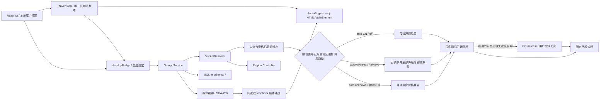

# 当前架构与 P0 边界

2026-11-03 维护补充：缓存目录锁统一由 `internal/dirlock` 管理；本工程 panic 入口接入独立、有界且默认脱敏的 `internal/crashreport`。网络/解码任务按经过审计的失败路径隔离，内部状态异常记录后终止；完整范围与限制见[维护加固](maintenance-hardening.md)。Wails Go/runtime 继续固定 3.0.0，补丁依赖升级不代表重新通过所有历史原生验收。

> 2026-11-02 / 0.5.3 源码同步。实现状态与验收状态分别记录；真实网络、原生 WebView2 和阶段结论以 [P0 验证记录](p0-validation.md)为准，本文不新增实测通过声明。

项目根目录是唯一 Go module `github.com/voici5986/otoneigo`，前端位于 `frontend/`。React 通过 Wails 3 生成绑定调用同进程 Go 服务，不运行独立本地 HTTP API 进程。三个参考副本保持只读、被 Git 忽略。

`main.go` 加载内嵌前端资源，生产构建使用 `production` tag。窗口采用系统标题栏，初始 1200×800、最小 900×640，实际退出经最多 3 秒持久化握手；closeToTray 默认 false，启用且托盘可用时关窗隐藏现有 WebView。同一数据目录的单实例限制使第二次启动聚焦已有窗口。数据目录可由进程级 `OTONEIGO_DATA_DIR` 隔离，默认 `%LOCALAPPDATA%\OTONEIGO`；不是用户数据迁移功能。

## 网络与解析

`internal/catalog` 独立实现匿名搜索、单曲元数据、歌词、普通取流和受限 header 取流。网易云 ID 经 `json.Number` 转字符串，无浮点中转；拒绝 API 重定向，媒体地址限制到受信任的网易云音频主机。没有账号会话、Cookie jar、Firebase、UNM 或其他曲库。

`internal/stream` 先复用合资格的已验证本地缓存；网络取流按解析开始时的设置与地区选择路径：`auto+CN` 仅普通网易云，`auto+overseas` 与 `always` 从首个请求及所有降级档位直接使用兼容头、不先试普通请求，`off` 仅普通请求；`auto+unknown`（含检测失败）保留普通失败后合资格兼容的有界回退。所选网易云路径的有限音质链均失败后，才允许已启用、限速的同 ID GD；完整可播网易云结果立即接受，不为追求更高码率调用 GD。同一次解析共享有界 deadline：未确认会员为 26 秒，已验证会员策略为 40 秒。普通与兼容阶段分别共用 4、5 秒，GD 阶段最多 17、31 秒，以容纳六秒最短请求间隔；未选择的普通阶段不发送请求，也不把其预算扩展给兼容或 GD。等待、降级、探测和启动均受剩余总预算约束。普通优先分支的试听、未授权及明确登录要求阻止后续 header 改写；已经选择直接兼容的分支无需普通探测，仍按实际返回和权限规则处理。取消、限流、无效 ID/音质、ID 不匹配、不可信地址和无效响应停止后续尝试。兼容连续失败三次后冷却一分钟；直接兼容分支在冷却时不改试普通请求，只尝试合资格 GD 或返回 `COMPATIBILITY_COOLDOWN`。网络或策略失效清理相关状态。GD 也失败时保留具体的网易云权限结果（若有）；兼容失败不被改写成已确认的地区限制。

地区控制器启动异步查询 Cloudflare trace，只提取国家码，输出 `CN / overseas / unknown`、国家、观测时间、检测状态和网络 generation，不暴露原始公网 IP。检测上限 4 秒、TTL 15 分钟、最短重试间隔 30 秒。Windows 路由/接口通知、5 秒接口指纹检查、休眠间隔检测和 500 毫秒去抖触发网络失效；设置页可手动重检。检测路径不证明网易云 API 或 WebView2 媒体出口相同。

`auto` 区分 CN、已确认海外与未知；`always` 不依赖地区且直接兼容；`off` 仅普通。当前兼容只允许 `POST https://music.163.com/weapi/song/enhance/player/url/v1` 添加版本化固定协议提示头，保留 TLS 校验；CDN 主机改写和 no-cache 未实现。登录/扫码/认证仍未实现，也不在此白名单内。详见[海外兼容说明](overseas-compatibility-p0.md)。

## 状态、媒体与存储

`PlayerStore` 唯一持有运行时队列；Go 仅存快照。`AudioEngine` 只有一个 HTMLAudioElement，不设置匿名 CORS 模式、不使用 WebAudio。切歌/暂停、网络 generation 与策略变化会取消待解析/待启动请求，generation 拦截迟到结果；已在播放的媒体不会因地区观测迟到自动换源。解析返回的 deadline 也约束媒体启动；所有 `status=full` 结果和全部 GD 结果都对同一实际 Audio 元数据检查时长完整性。API 返回 URL、元数据检查与真正完整播放是三种证据。

SQLite schema 7 提供本地收藏、历史、设置、关键词历史和队列元数据。收藏/历史按歌曲、歌手、专辑在 SQLite 整库检索，无需网络 hydrate；收藏按 added_order 降序及 song_id 升序、历史按 (played_at, entry_id) 降序游标分页，每页最多 200 条。前端替换当前页 metadata，保留游标用于前后翻页，不无限累积 DOM；独立完整收藏 ID 集合负责爱心判断。不自动裁剪收藏、播放历史或关键词历史；关键词界面只显示最近 20 条，不代表数据库保留上限。历史在 `playing` 状态累计至少 500 毫秒有效媒体时间增量后写入，每次播放尝试最多一次；不是 resolve 成功即写入，也不向网易云上报。队列先读后写、revision 串行保存、暂停恢复；详情见 [storage.md](storage.md)。

`frontend/bindings/` 由 `wails3 generate bindings -ts -i` 生成，业务经 `desktopBridge`/`wire.ts` 收敛字段、错误与取消；禁止手改生成文件。AppService 已暴露本地库、设置、能力和地区状态/刷新方法，不再只是五个 PoC 方法。

诊断输出为数据目录下 `log/playback.jsonl`，固定白名单字段记录 API 阶段、歌曲 ID、国家、策略、provider、状态、请求/实际质量、实际格式/码率、错误标签和耗时。超过 1 MiB 轮换至单个 `.old`。已知安全失败码保留，未知错误收敛成 `UNKNOWN`，不保存地址、响应体、Cookie/token；框架常规日志被关闭。诊断失败不改变播放结果。

实际退出由 Go `lifecycle.CloseGate` 与前端 `prepareClose` 协作：冻结交互，等待 hydrate，暂停并 flush 已排队的队列/库/设置保存，回传匹配 token 后重入关闭；无响应时 3 秒上限兜底。ack 表示这次保存尝试结束，不表示每次保存成功；仍仅保证已经提交的数据，强杀不会运行此握手。

## 桌面观察窗口（0.5.0）

`main` 是唯一创建 PlayerStore/AudioEngine 的入口；`mini` 与 `lyrics` 仅在首次请求时创建，隐藏后复用，未知 view 不创建播放器。两者复用 OTONEI 展示风格，读取白名单投影、转发控制命令；歌词进度读取主 Audio 实际时间，不运行独立播放时钟。主窗口隐藏后仍持有队列与音频。

Go `desktopstate.Hub` 校验框架 Sender、epoch、递增 sequence、字段白名单与 64 KiB 大小上限；发往主窗口的命令/刷新/epoch、发往浮窗的快照使用定向 `DispatchWailsEvent`，避免固定 Wails 版本的全局 `EmitEvent` 广播回流。导航递增 epoch 并重新握手；终止关闭推进 sequence、锁定 closing，迟到发布和导航不能重新开放命令。浮窗同样拒绝旧 epoch/sequence 和关闭后的复活。主投影最多约每 250 ms 合并发布一次。

桌面选项和原生几何共享设置提交锁，分别合并数据库最新值；位置采用 Wails DIP Bounds/屏幕 WorkArea，显式 `WindowXY` 恢复，保留负坐标多屏布局并夹取可见工作区。移动/缩放延迟 350 ms 保存，最终关窗停止旧任务、读取已就绪窗口最终 Bounds 并在数据库关闭前 flush；不把创建过程的未就绪几何写回。位置和桌面设置契约随 schema 5→6 在同一事务升级，详见 [存储协议](storage.md)与[窗口协议](desktop-window-protocol.md)。

曲目通知默认关闭，仅实际开始播放的新队列项且主窗口隐藏/最小化时请求，使用本进程自有托盘，不注册 toast/注册表项。任务栏标题、状态与进度来自同一投影，COM 创建、调用和释放均在 UI 线程；失败降级不影响播放。原生 API 接受状态不等于用户实际看到通知。0.5.0 的原生验收与 production/ZIP 证据须另见 [P0 记录](p0-validation.md)，不能沿用下述 0.4.0 通过结论。

## 独立能力门

GD 适配器已实现同 ID `source=netease` 请求、元数据交叉检查、通过 audioinfo 的 MP3/FLAC/WAV 有界结构探测、真实码率推导、短内存缓存、合并/限速/冷却与取消。它仅接受受信任 HTTPS 网易云媒体，时长一致仍不能证明同一录音版本。`gdReleaseValidated = true`：生产 capability 已开放，用户开关仍默认 false，只有主动启用才尝试备用。放行依据为 2026-11-01 历史批次未拦截的原生 GD MP3 自然结束（267.245714 秒）、自动下一首和单 Audio，以及同样本网易云兼容路径与 GD 整文件一致；不是所有歌曲、权益或音质通过。完整记录见 [P0 验证](p0-validation.md)。

账号/QR/DPAPI 会话、云端歌单/同步和自动升级仍未实现。托盘显示/隐藏、播放命令、退出及系统媒体控制已接入同一 PlayerStore；原生托盘隐藏/恢复连续播放已验证；实际 WinRT Pause/Play/SkipNext 与不同队列项路由、单 Audio 已通过；普通暂停保留媒体源/元数据以维持系统会话。完整 GUI 与 MVP 的若干部件已提前落地，不等于 P1/P2 已验收。正式阶段仍按 P0-A（宿主）、B（网易云搜索/登录/取流）、C（地区检测/兼容）、D（GD）、E（原生媒体完整性/音质）审查。生产不编译 CDP；`p0debug` 只用于隔离验收，不能作为正式分发版本。

## 界面继承修正

当前 App/OtoneiPresentation/LibraryPanels 是 OTONEI 原版 App、DesktopNavbar、Header、SearchResultItem 及桌面播放器组件的展示适配；src/otonei 保留九份原始样式，局部桌面适配在 styles.css。早期单独编写的技术验证布局已退出当前产品界面。侧栏、搜索、原版卡片和底部/展开播放器继续使用一个既有 PlayerStore/AudioEngine；队列是播放器打开的抽屉。

歌词解析与最近时间译文对齐由展示层 memo 保存；不另建播放时钟。歌词打开时键盘可访问歌词和底部播放器，队列打开时仅访问抽屉；关闭最上层再恢复触发按钮与背景 inert。导航断点沿用 992px，Windows 最小窗口也保留可见顶部搜索。

## 音质资格和自动降级

Go `PlaybackEntitlement` 只由可信后端提供；只有 LoggedIn 与 Member 都确认才开放高级音质。当前生产入口仍是匿名 provider，账号能力继续关闭。`GetPlaybackQualityPolicy` 是只读策略接口，前端参数或本地会员标记不能授权高音质。未登录/非会员唯一手动首选为 exhigh/320000bit/s，GD 同样遵循；所有账号都不允许手动选择 standard/higher，二者只用于自动回退。旧低档首选或无会员的高档首选在启动/读取设置时归一到 320，并保留地区、GD 开关及音量。

每个来源按有限音质链尝试：320→192→128；会员高档从所选档位向支持的较低档位回退。保持所选访问路径及来源优先，普通或兼容完整低档返回即可使用，不为升级档位等待 GD 或曲中换源。每个来源内的权限/试听不阻止安全低档尝试，但全部失败时保留原权限原因，不误判地域；取消、限流或不可信响应停止链。无会员时，上游明确返回超 320 或高级格式/标签的候选会被拒绝，不能把它改名成 320。

GD 对相同 br=999 的多个高级档去重；单档缺失/不支持不累计服务熔断，网络连续失败仍有冷却。共享 GD 请求使用独立有界寿命和逐调用者取消，短调用者不会提前结束仍有效的长调用者。GD 媒体检查已接入 MP3/FLAC/WAV 有界结构解析，匿名音质上限与会员门控继续生效；真实 GD FLAC/WAV 及会员高级媒体链路尚待独立验收。

## 音频缓存与受限媒体通道（0.3.0 起）

`internal/mediacache` 在宿主进程内监听 `127.0.0.1` 随机端口，仅凭不可预测的临时令牌提供既有可信媒体的 GET/HEAD 与 Range；不是业务 HTTP API，也不接受任意远端 URL。仍只有一个 HTMLAudioElement。上游仅允许受信任的网易云 HTTPS 主机，保留证书与重定向验证。

缓存默认启用、20 GiB；每个合资格的质量档先查完整缓存，再请求该来源，保持所选普通/兼容路径先于 GD、以及 320→192→128 的有界顺序。缓存命中保留实际质量、provider 和 cache 来源，不把降级媒体重标成首选质量。下载先写 `.part`，可渐进提供字节，只有完整长度、MP3/FLAC/WAV 结构和时长检查成功并计算 SHA-256 后才提交 `.blob` 与 manifest。传输失败/中断不成为离线缓存；关闭缓存或缓存不可用时保留受限的直接播放退路。

活动 lease pin 防止清理/LRU 删除正在使用的媒体；普通已加载媒体暂停保留源/元数据，浏览器响应可能继续 pin 文件，清理标记活动项，完整释放后再删，Windows 删除失败保留计数并重试。容量和磁盘余量约束新下载，缓存不是下载管理或用户导出功能。高级媒体仅允许可信后端确认的同账号会员 scope；当前账号 capability 仍关闭，不能由本地设置获得会员权限。媒体地址与通道令牌只在内存中存在，库/队列/manifest/日志均不持久化签名 URL。存储细节见 [storage.md](storage.md)。

0.3.0 历史批次真实 CDN 的原生渐进播放、完整缓存提交、热播与 Range seek 已有独立报告；自生成 FLAC/WAV 在真实 WebView2 各自然结束 3 秒，但其 resolver/媒体受控拦截，不证明真实会员或缓存传输。另外的实际 WinRT 控制及进程级离线缓存重启/seek 已通过；最终完整测试、生产构建和 portable ZIP 四文件哈希核对已通过，见 [P0 记录](p0-validation.md)。

暂停会取消待解析/待启动或渐进下载任务，但已稳定加载媒体保留源/元数据以维持 SMTC。待启动取消、选曲/移除、退出/销毁执行完整源复位；恢复播放重新解析并查合资格缓存。清理不以一次 pause 就保证文件立即可删。原生离线报告确认关闭缓存与清理不打断当前播放，最终清空是在完整源复位/释放后观察到。

## 封面与歌词资源缓存（0.4.0）

`internal/resourcecache` 与音频缓存分开，在 `cache/resources/` 存储已验证的公开资源；默认启用、封面与歌词共享 1 GiB，可设 64 MiB..1 TiB、关闭或清理。设置由 SQLite 保存；manifest 只含散列键、种类、长度、摘要与时间，不含原 URL 或凭据。资源损坏会移除并重新获取；缓存不可用时保留普通联网退路。

`ResolveCover` 仅接受快照已有的可信 HTTPS 网易云封面引用。JPEG/PNG/GIF 需通过 4 MiB 上限、尺寸/像素门和完整 Go 解码，WebP/AVIF 走可信原地址退路。缓存获取在已通过无 query 白名单校验的原始封面引用上，仅为内部网易云显示图请求添加固定 `param=1024y1024`；输入引用仍拒绝 query，快照、回退和缓存键仍使用原始 canonical 引用。响应依据字节完整解码而非 HTTP MIME 判定。已缓存封面返回 `/artwork/<hash>`，由现有 Wails 同源资产管线读取校验后的内存 buffer，设置 `Cache-Control: no-store`；不增开监听端口，也不把运行时路径写回曲库。音频通道同样使用 no-store，避免浏览器 HTTP 缓存重复保存受控媒体；它不同于尚未实施的上游 CDN/no-cache 兼容实验。

歌词按字符串歌曲 ID 缓存，单条 JSON 最多 1 MiB；非空有效缓存立即返回，超过七天时异步刷新，失败保留有效旧值并以五分钟间隔抑制重复刷新；空结果不作永久缓存。封面/歌词任务分别由 4/2 个 worker 执行，全局最多 64 个在途任务，封面提交达到 60 个时不再占满余下名额；相同资源合并请求。管理器具有目录寿命锁，退出取消任务、等待收尾再释放锁，清理和关闭使用 generation 阻止旧任务重新提交。

资源缓存不扩大任何播放权益，不新增播放器或队列。0.4.0 原生在线/进程级离线资源、查询、强杀恢复及生产 ZIP 覆盖更新已通过有限用例，证据见 [P0 记录](p0-validation.md)；0.3.0 历史通过记录仍只证明其注明条件。

当前海外直接兼容规则取代旧版对所有地区普通优先的策略；历史普通失败/兼容成功样本保留原条件。实际 TH/overseas、auto、无网络拦截的原生 WebView2 已验证新路由：样本 33894312 普通/兼容/GD 请求数为 0/1/0，实际 320 kbps、启动 1435 ms、媒体时长 267.245714 秒；另一同 ID GD 回退样本为 0/3/1、启动 2209 ms、时长 227.731917 秒，均只有一个 Audio。此次验证是启动与媒体时长检查，不是两首完整自然结束。资源/查询、离线和强杀报告使用旧路由，不单独作为此次顺序证明；新路由由 `output/playwright/native-egress04-report.json` 独立记录。

资源验收使用同一原始封面引用：原图 PNG 6,050,435 字节，内部固定显示参数返回可完整解码的 1024×1024 PNG 1,863,113 字节，尽管 HTTP 声称 image/jpg；未换用 fixture 或改写 coverRef。强杀发生于 163,840 字节未完成音频下载，重启精确恢复已提交 revision 44 / 3000 ms，未完成音频清理至零，资源缓存仍可读。0.4.0 最终 Go 全量测试/vet、149 个前端测试、TypeScript/Vite、Windows production 构建及 13 份 Go 许可通知审计通过；portable ZIP 四文件白名单及各 payload 哈希与最后构建输入一致。

## 0.5.1 热读、持久化与回调边界

封面在下载/启动载入时完整解码校验一次，保存有界内存摘要/MIME；HTTP热读在状态锁外读取并计算SHA256，再校验代次与身份，不重复解码或放宽损坏检测。保留no-store，源散列URL不是immutable内容地址。音频冷校验按条目合并并在全局锁外执行，pin和清空代次防止旧校验重新创建已清理状态；渐进响应复用支持Windows删除共享的句柄。LastAccess只在内存标dirty，每5秒合并manifest，Close尝试flush；结构提交/失效仍同步持久化。

GetSettings仅返回当前资格的有效视图，不重写偏好。提交和原生位置合并仍在设置锁内；通知在锁外单一drain，允许重入并把并发更新合并到最新完整快照。匿名界面修改音量等不会覆盖保存在库中的高级偏好，但播放资格没有放宽。曲库资料失败可整体重试；写入保持当前筛选/游标页，seek即时更新音频并250ms合并快照。GD资料短缓存、预算准入及共享API生命周期见[0.5.1核实记录](audit-fixes-0.5.1.md)，来源顺序、六秒间隔与总时限不变。

## 0.5.2 初始化、验证和隔离边界

资源New只加载有界manifest及文件属性；封面/歌词payload延迟到使用，封面首验按key合并、四槽、锁外执行。调用方可取消等待，共享验证不被一个短调用者取消；clear/disable/close取消旧代次排队任务，入槽后再核对身份。验证失败即使Windows无法unlink也撤销信任和广告本地URL，保留物理占用记账；网络重取无法替换时回退可信原图。

音频下载完整提交时同一读取过程生成全文件SHA和1MiB块摘要。索引记录命中以校验ReaderAt做有界结构检查，HTTP从该次hash成功的同一缓冲区发送；首个请求块失败410，后来块失败中断并使后续请求410。旧记录第一次仍完整校验并补建持久索引，未请求中间块到读取时才检查，不再把当前全文件hash作为每次新进程出首字节的前置条件。Lookup先取候选身份快照再解锁验证。

schema7事务隔离逻辑坏行并保留原SQL值；设置在Open恢复，当前schema的库记录在读取时分批隔离，不引入全历史启动扫描。新GetStorageRecoveryStatus只返回计数/设置恢复标志，主界面提示、诊断固定码，不传原文。初始化先完成页面隔离再取得收藏ID。未知设置字段与别名递归合并，冲突拒写；明确清空历史同时删除历史隔离记录。日志轮转/写入失败有界重试，Status与Close公开脱敏失败而不阻断音乐。准确源码/合成/原生证据见[0.5.2审计](audit-fixes-0.5.2.md)，此节取代上方旧版本启动全量内容校验合同。

## 0.5.3 队列、接纳和空闲生命周期

资源验证两槽与网络封面四槽/歌词两槽分离；已缓存未首验的图片不排在网络后。ResolvePrepared把来源解析和缓存接纳放在同一原始截止时间及配置/网络代次内；缓存接纳失败只一次skip-cache重解析、不再接纳，不复用持久化签名地址。完整可信网络结果在缓存不可用时可直接播放，地址信任与unknown/试听状态语义分开。

频繁LastAccess增量写入有界recency.json，以Generation/结构访问基线关联；结构manifest仍保存Chunks，失败保留structuralDirty由reaper或Close恢复。会话提示签名只在主界面内存，知道了不删数据库；恢复30秒检查，缓存统计仅设置页。跨挂载未完成统计按Store合并，发布受活动性和请求revision双重保护。精确边界及独立/原生证据见[0.5.3审计](audit-fixes-0.5.3.md)，此节替代旧版共用首验下载槽和全局缓存统计轮询描述。
