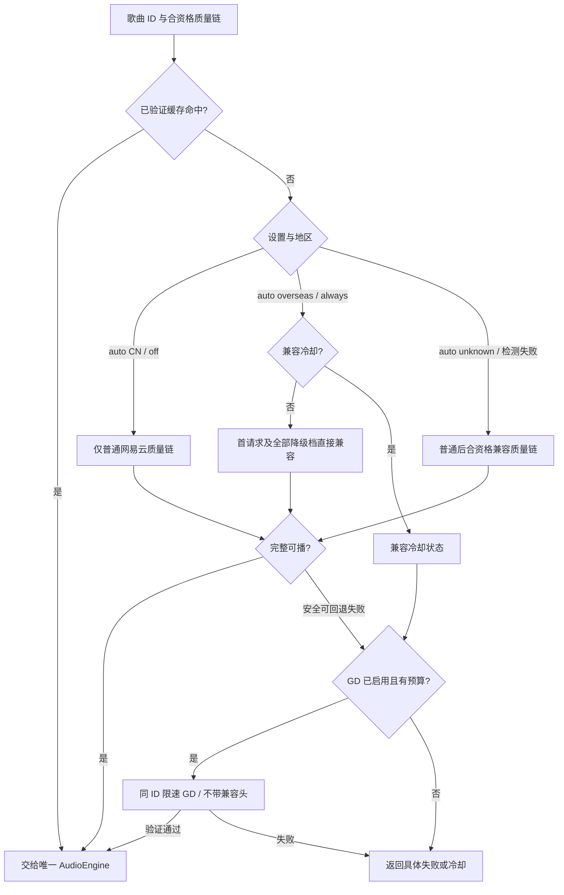

# 海外网络兼容 P0 实验与决策

> 2026-11-02 / 0.4.0 策略修正同步（保留此前普通优先及 2026-10-31 隔离实验历史）。地区检测、设置和受限 header 取流已接入当前客户端；GD 适配器已按有限 MP3 原生样本开放发布 capability，用户设置仍默认关闭，账号及 CDN/no-cache 未实现。代码落地不等于原生验收通过；当前证据及 go/no-go 以 [P0 验证记录](../validation/p0-validation.md)为准。主阶段和范围见[实施方案](../../OTONEI_Windows_Netease_Implementation_Plan_2026-10-31.md)。

## 1. 目标、证据与参考边界

在泰国等海外网络验证匿名免费歌曲的真实播放闭环，并区分地区、账号权益、歌曲状态、API 与媒体传输失败。海外出口是实验变量，不是空 URL 的既定原因。普通请求下原 SDK、官方 musicfox、DNS/受控解析对照均失败；2026-10-31 独立 header A/B 对歌曲 `33894312` 得到约 267 秒 MP3，并在原生 WebView2 静音完整播放、自动下一首和定位恢复。Go 检测服务路径观测国家为 TH，但尚无同条件中国出口 A/B；不能据此或仅凭 item 404、`pl=0`、海外 DNS 就确认地域根因。它是一个歌曲/音质/端点的实验结果，不代表所有曲目、会员权益、音质或网络都可用。详见验证记录中的实测与限制。

本地只读参考 `NetEaseMusicWorldNext-master/` 为 Manifest V3、版本 1.0.0、GPL-3.0 扩展。观察到的机制与本项目边界如下：

| 参考中的机制 | 观察范围 | 当前实现或保留边界 |
| --- | --- | --- |
| `background.js` 动态请求规则写 `X-Real-IP`、CDN `no-cache` | 对网易云请求范围较宽；示例固定 IP；图标开关默认开启 | 不复制源码；当前独立 Go 实现使用版本化固定提示值，仅作用于单一取流端点；可用性与维护仍需持续验证，用户可关闭 |
| `page-script.js` 处理成功的播放 URL 响应 | 将 `m<number>.music.126.net` 改为 `m<number>c.music.126.net` | 尚未实现；保留为独立候选实验，不对全部主机做字符串替换 |
| `content-script.js` 注入页面脚本 | 扩展页面上下文 | 不引入 Chrome 扩展运行时、页面注入或浏览器扩展依赖 |
| `rules.json` 静态规则 | manifest 的 `rule_resources` 为空，与动态规则不同 | 不将未启用的静态规则写成实际生效机制 |
| 出口检测、认证排除 | 未见自动 IP 检测，也未见明确登录/QR 排除 | 本项目另行设计，不能声称参考已验证这些保护 |

GPL 扩展及 go-musicfox 主程序只作行为参考，保持只读，不复制实现进 MIT 客户端。只使用网易云歌曲身份和合法可访问资源，不引入 UNM、其他曲库、自建远程 Go API、独立本地 HTTP API 进程或全局 DNS/Hosts/代理改动。兼容实验不修改会员标志、版权/权益字段，不承诺获得 VIP 完整音频。

## 2. 出口检测与用户设置（TH 有限原生验证通过，其余分组保留边界）

`internal/region` 启动后异步查询 `https://www.cloudflare.com/cdn-cgi/trace`，仅提取国家码；API 暴露 `CN / overseas / unknown`、国家、观测时间、检测中/错误及 networkGeneration。不依据 Windows 语言或时区，不把原始公网 IP 传 JS、日志或 SQLite。拒绝重定向、响应上限 16 KiB、检测预算 4 秒；TTL 15 分钟、最短重试 30 秒，后台每 30 秒检查刷新资格。检测不阻塞正常播放，设置页支持手动重新检测。

| 设置 | 当前行为 |
| --- | --- |
| `auto` + `CN` | 仅普通网易云有限音质链，不发兼容请求 |
| `auto` + `overseas` | 首个取流请求与全部降级音质直接使用兼容头，不做普通预请求，也不在兼容失败后回退普通 |
| `auto` + `unknown`（含检测失败） | 保留普通请求先行；合资格失败后尝试有界兼容音质链 |
| `always` | 不等待地区检测，首请求与全部降级音质直接兼容，不发普通预请求 |
| `off` | 仅普通网易云，禁用兼容 header |

以上网络路径均先复用合资格已验证缓存。路径在解析开始时按设置与已有地区观测选定；未得到观测时按 unknown 处理，不阻塞等待检测。所选网易云有限音质链失败后，才允许已启用、受限速的同 ID GD；完整可播网易云地址立即接受，即使质量低于偏好，也不为更高码率调用 GD或曲中换源。兼容连续失败三次冷却一分钟，网络或策略失效清理状态。直接兼容分支遇到冷却不退回普通请求，只尝试合资格 GD 或返回 `COMPATIBILITY_COOLDOWN`。GD 从不带该兼容头，地区策略关闭不关闭其独立开关。

该规则取代旧版对所有地区普通优先的策略；下文历史实验及旧验收仍保留当时条件。已有 0.4 原生资源/查询、离线与强杀检查使用旧路由，不证明新策略实际 HTTP 首请求或播放效果；新策略已由独立 `output/playwright/native-egress04-report.json` 验证实际 TH/overseas auto 请求顺序及原生启动，详见下方有限证据。

Windows 原生接口/路由通知、5 秒接口指纹检查和大于 45 秒的休眠间隔检测，经 500 毫秒去抖触发 generation 递增、取消待检测/待解析请求并重检。不能保证捕获所有 VPN/Tailscale 出口变化；实际切换/恢复仍须独立验收。迟到检测不自动替换正在播放的 src。

分流时检测服务、网易云 API 与 WebView2 媒体可能走不同出口。国家码只是检测路径观测；中国 Tailscale exit node A/B 必须记录实际路由/代理条件。不得自动改系统代理、DNS 或 Hosts。

## 3. 受控兼容请求与未实现候选

取流按上表预先选择普通、直接兼容或 unknown 的普通后兼容路径；直接兼容对首请求及所有有限降级档位使用同一受限 header，不是先普通失败再重试。当前唯一白名单是无 query/userinfo 的 `POST https://music.163.com/weapi/song/enhance/player/url/v1`，只为该请求添加版本化固定 `X-Real-IP` 提示（`RegionHintVersion`）。这是可撤销的协议实验，不是客户端实际地理位置、合法权益或普遍有效性的保证。关闭设置可撤销使用，源码版本标识支持审计和后续维护。

搜索、歌词、元数据、地区检测与 GD 不带该兼容头；没有账号/Cookie jar。登录/QR/认证尚未实现，未来仍必须使用独立正常路径，不扩大取流白名单。TLS/证书校验保持开启，API 重定向拒绝。

CDN `m<number>` → `m<number>c` 候选改写和媒体 `no-cache` **尚未实现**，不计作已启用策略。将来若实验，须独立收窄主机、校验 HTTPS/重定向/Range 和签名语义，不覆盖已经工作的原地址，不做任意主机替换或开放代理。

当前同一次解析共享会员资格对应的总 deadline（非会员 26 秒、已验证会员 40 秒）：普通阶段最多 4 秒、兼容阶段最多 5 秒、启用的 GD 阶段最多 17/31 秒。直接兼容路径不发送普通阶段请求，也不将未用的 4 秒扩展给其他阶段；unknown 路径才可顺序使用普通及合资格兼容阶段。各阶段的有限质量降级共用本阶段预算，并遵守 GD 最短六秒请求间隔。等待、限速和 GD 媒体探测均消耗剩余预算，不重启 deadline。返回 deadline 继续约束前端媒体启动；这是一项上限契约，不是播放时延 SLA。

普通优先分支的试听、未授权及播放器接口明确登录要求阻止后续地域头改写；直接兼容分支按已选路径请求，无需普通探测，实际返回仍按权限/音质规则处理。所选网易云质量链均失败后，用户启用 GD 时可独立进行有界同 ID 备用取流。限流、取消、无效 ID/质量、响应 ID 不匹配和不可信/无效响应停止后续尝试；任何完整可播网易云结果立即使用。GD 备用必须 full、ID 一致、provider=gd-netease 且地址非空，并继续由 GD 适配器校验 HTTPS/音频/时长。GD 失败时保留具体权限结果（若有），兼容实验失败不确认地区根因。切歌、网络/策略变化和退出取消旧结果；账号尚无会话 generation，不宣称已验证换号隔离。

## 4. 单身份、单播放器与传输边界

`neteaseSongId` 始终是字符串且不变。地址提供方仍为 `netease-direct | gd-netease`；独立字段 `accessStrategy = normal | region-header | cdn-compat` 仅标识访问策略，不是新增曲库/provider。GD 只允许同 ID、`source=netease`，实现有独立用户开关与发布 capability 双门。当前 `gdReleaseValidated = true`，生产提供可选入口，用户开关默认 false；有限 MP3 原生样本放行不代表其他曲目、权益或质量通过。地区策略关闭不代替 GD 的独立开关。

Go API 能返回 URL，不等于 WebView2 能加载媒体。分别记录 API 响应、Go 媒体探测、原生 WebView2 实际播放；必须验证 HTTP 状态、MIME、重定向、Range/206、seek、真实播放时长、试听/完整性、返回质量/格式与歌曲版本一致性。同 ID 不足以证明 GD 返回同一版本，质量标签也不足以证明真实音质；未知保持未知。

所有结果交给现有单一 AudioEngine 和前端唯一队列所有者。0.3.0 已增加同进程 loopback 媒体专用通道：随机端口、临时令牌、GET/HEAD/Range 与可信上游校验，只将音频字节交给同一执行器。它不是业务 API 或独立进程，也不是 CDN 主机改写。该通道支持渐进播放和已验证磁盘缓存；不得把浏览器 mock 当原生 WebView2 通过。

媒体 URL 只存内存。普通/兼容解析无 URL 缓存；GD 按 songId/quality 合并请求并短缓存（最多 30 秒），网络/策略 generation 失效时清理并取消旧任务。磁盘字节缓存另按 provider/实际质量/格式/码率及账号 scope 隔离，默认启用、20 GiB；高级内容必须匹配可信的当前账号会员资格。账号未实现，scope 测试不等于真实登录/换号已验收。不得持久化媒体 URL、Cookie、token 或签名参数。GD 仅接受同 ID、受信任 HTTPS 网易云媒体，通过 audioinfo 检查有界 MP3/FLAC/WAV 结构证据、长度、码率与相对元数据的时长（实际发布样本仍仅 MP3，非真实会员高级媒体验收）；不把同 ID/时长当录音版本证明。具体限制见[适配器说明](../architecture/netease-adapter.md)。

## 5. 错误、日志与展示

区分兼容冷却 `COMPATIBILITY_COOLDOWN`、确认的地区限制、`regionSuspected`、会员/账号权限不足、试听、空 URL、限流、超时、TLS/网络失败、格式不支持和媒体加载失败。顶层 200 不等于单项成功，单项 404 不等于确认地区限制；无权访问不被转换成已授权状态。

当前固定字段诊断在 `log/playback.jsonl` 记录白名单 stage、songId、国家码、accessStrategy、provider、status、请求/实际质量、实际格式/码率、安全错误标签及耗时；1 MiB 后轮换一个 `.old`。已知安全错误码保留，未知标签收敛为 UNKNOWN，不记录原始 IP、响应体、完整地址/签名、Cookie/token 或登录内容。现有记录不是完整媒体遥测，也未记录账号类别或 generation；验收报告另记这些上下文。框架常规日志关闭，避免绑定载荷泄漏。

UI 显示不可播放/试听/未知音质等状态，不将 item 404 或 unknown 出口显示成确认地区限制，不承诺 VIP 解锁。

## 6. P0 A—E 验证矩阵与进入 P1 的门槛

**正式 P1 前完成 A—E 的验证工作与明确 go/no-go 决策。** 匿名免费歌曲真实可播仍是核心硬门槛；可选账号、兼容或 GD 失败可形成禁用/延期/移除决策，不能把失败或未测试计为能力通过。条件缺失的格子标记“未测试/条件缺失”，阶段决策需明确延期范围及依据；不得以“可选”跳过结论直接宣称 P0 全部完成。

| 分组 | 必测工作 | 通过证据/决策 |
| --- | --- | --- |
| P0-A Wails 3 + React + Go 基础运行 | Windows Wails/React/Go 窗口与绑定；去 UNM/许可；最小 SQLite 元数据快照与离线重启 | 当前 schema 5 已含收藏/历史/设置/本地歌单、整库检索、分页及关键词历史；历史不自动裁剪，基础运行、升级与耐久验收需分别记录 |
| P0-B 网易云搜索、登录与播放地址获取 | 搜索、歌词/封面、普通播放地址；泰国免费/VIP 样本；匿名、普通账号、会员账号；QR、会话/过期/退出、只读资料/歌单；各权限/质量独立记录 | 匿名免费曲目真实可播仍为核心门槛；无会员条件标未测试；账号未实现不作成功；独立 go/no-go，不伪造权益 |
| P0-C 海外 IP 自动检测与地域兼容验证 | 泰国 `auto/always/off`；header、CDN、no-cache 分别 A/B；中国 Tailscale exit node A/B；分流/API 与媒体出口差异；检测失败、缓存、网络切换/恢复、有限预算与冷却；登录/QR 隔离 | 各策略真实效果及启用/禁用决策；不自动改系统网络；TLS 不放宽；旧请求取消、当前播放不迟到换源；无中国出口条件不作地区因果结论 |
| P0-D GD Music 备用播放与失败回退 | 所选网易云普通/兼容质量链失败后 GD `source=netease`；同 ID 免费/VIP、不同 br、时长/版本一致性；空地址/限流/超时/取消；完整网易云可播不调用 GD 追高码率 | 明确保留/禁用/移除；同 ID 但版本/完整性未知不能算通过；未启用则不发请求 |
| P0-E Windows 实际媒体完整性与音质 | Go API 与媒体探测、原生 WebView2 真播放分别记录；Range/206、seek、连续播放、完整时长/试听、各质量/格式和版本一致性 | API 返回 URL 不算原生成功；真实音质未知保持未知；单 AudioEngine、切歌/取消和迟到响应验证通过 |

每格记录网络/设置、songId、账号测试类别、请求/实际质量、试听/完整性、API 与原生播放各自结果、失败类别、尝试数和预算；用“live/mock/optional/failed/untested”区分证据，不保存敏感原始内容。免费与 VIP 样本、匿名/普通/会员、普通/中国出口及不同质量应交叉覆盖；不能用一个成功样本替代全部格子。

当前受限模块已落地，后续保留历史普通失败/兼容成功对照，验收实际绑定路径 → WebView2 媒体完整性/音质（真实 VPN/Tailscale/中国出口对照按用户要求暂缓，不计通过） → A—E 报告和能力决策 → 核心全过后正式 P1。架构与许可证约束见[架构](../architecture/architecture.md)、[许可证](../delivery/licenses.md)，已执行检查见[P0 验证记录](../validation/p0-validation.md)。

## 7. 本轮有限放行与显式延期

2026-11-01 历史批次 GD 在未拦截的原生 WebView2 路径自然结束于 267.245714 秒，自动下一首且保持一个 Audio；网易云兼容路径与 GD 同样本整文件 4,276,601 字节、SHA-256 `4a16a7c0d10eed3468361709295aaffb088b46836f3fe542d676dc32c02b88b0` 一致。由此开放可选 GD 发布 capability，用户默认仍关闭。不同曲目、实际权益及非 MP3/其他音质不由该单样本背书，完整网络/API/原生条件和 A—E 决策以 [P0 记录](../validation/p0-validation.md)为准。

账号/云端能力、CDN 改写与 no-cache 明确延期；真实 VPN/Tailscale/中国出口对照按用户要求暂缓；物理网络切换和 DPI 等组合保留条件具备后的验证，不计作通过。最终报告完成前不宣称匿名基础验收已最终交付，也不宣称 P1/P2 全部完成。

当前音质政策详见[架构](../architecture/architecture.md)：未确认会员手动只选 320，192/128 仅自动降级，GD 同政策。账号与会员实测尚未交付；不能根据新策略接口或测试桩宣称会员高级音质已可用。

## 8. 0.4.0 直接兼容路径的有限原生验证

`output/playwright/native-egress04-report.json` 在真实 TH/overseas、auto、未模拟地区且无网络拦截的 Wails WebView2 中观察：样本 33894312 普通/兼容/GD 尝试数 0/1/0、实际 320 kbps、启动 1435 ms、媒体时长 267.245714 秒；GD 同 ID 回退样本尝试数 0/3/1、启动 2209 ms、媒体时长 227.731917 秒。均为单 Audio，设置与本地库保留，原队列恢复暂停。该结果验证海外无普通预请求、完整网易云立即使用与兼容失败后的 GD 回退，但只观察启动/元数据时长，不是本轮完整歌曲自然结束。

资源/查询、进程级离线与强杀耐久报告采用旧路由，不能用于证明新顺序；其通过范围另见[存储协议](../architecture/storage.md)。新策略冷却、unknown/CN 和设置分支有针对性自动回归；真实中国出口、账号/会员、VPN/Tailscale/物理网络切换仍未验证或按要求暂停，不由 TH 两个样本外推。最终 Go/vet、149 前端测试、TS/Vite、Windows production 构建、13 份 Go 许可通知与 portable ZIP/hash 已通过；全阶段门结论仍由 [P0 记录](../validation/p0-validation.md) 单列。
